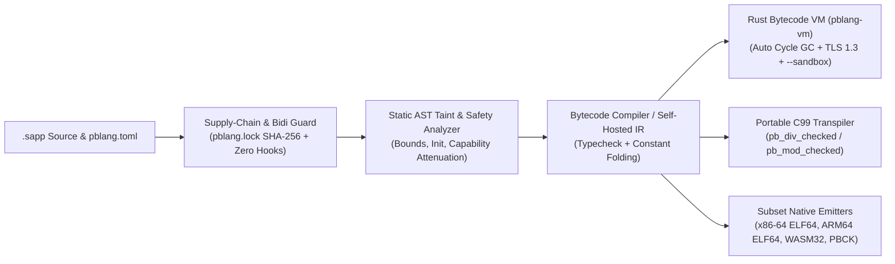

<div align="center">


# PBLang `1.4.0`

**Full-Stack, Systems & Security-Focused Programming Language & Multi-Backend Toolchain.**  
*Write `.sapp` programs targeting the capability-gated bytecode VM, portable `C99`, native subset compilers (`x86-64 ELF64`, `ARM64 ELF64`, `WebAssembly`), desktop/web UI surfaces, and embedded targets.*

[](https://github.com/PanosBiazis/pblang/releases/tag/v1.4.0)
[](LICENSE)
[](#100-pblang-native-compilation-x64-arm64-wasm-pbck)
[](#architecture--implemented-surface)
[](SECURITY.md)

[Quick Start](#quick-start) · [Why PBLang?](#why-pblang) · [Examples](examples) · [Documentation](docs) · [Tests](tests) · [Security Policy](SECURITY.md) · [Changelog](CHANGELOG.md) · [Releases](https://github.com/PanosBiazis/pblang/releases)

</div>

---

## Why PBLang?

**PBLang (`1.4.0`, Edition 2026)** pairs a fast, capability-gated Rust bytecode VM (`pblang-vm` with automatic cycle GC, out-of-the-box `ring` TLS 1.3, and usable `--sandbox` isolation) with a rich pure-PBLang standard library, self-hosted compiler pipeline, native subset code generators, declarative UI builders, and deterministic hardware emulators:

| Pillar | Capability Highlights | Key Modules |
| :--- | :--- | :--- |
| **1. Production Bytecode VM & Multi-Backend Compilers** | Rust host VM (`pblang-vm`) with automatic trial-deletion/root-tracing cycle GC across arrays, maps, modules, upvalues, and closures, plus pure-PBLang self-hosted compilers (`selfhost_vm`, `selfhost_interp`, `native_pbck`, `c99_transpiler`, and numeric/subset emitters for `x86_64_elf`, `arm64_elf`, and `wasm32`). | `crates/pblang-vm/`, `tools/pbc.sapp`, `stdlib/compiler/backend_parity.sapp` |
| **2. Usable `--sandbox` & Out-of-the-Box TLS 1.3** | `pblang run script.sapp --sandbox` permits canonicalized, traversal-safe `stdlib:...` imports while denying filesystem, network, HTTP, SQLite, FFI, subprocess, spawn, and env access; `stdlib/tls.sapp` works out of the box via built-in `rustls` + `ring` TLS 1.3. | `src/main.rs`, `crates/pblang-vm/src/vm/net.rs`, `stdlib/tls.sapp` |
| **3. Declarative UI & Multi-Surface Builders** | Build Desktop (`X11`), Hardened Web (`CSP/HSTS`), Android (`APK/DEX`), CLI, and TUI surfaces from declarative view trees (`stdlib/modern_ui.sapp`, `stdlib/app.sapp`). | `stdlib/modern_ui.sapp`, `stdlib/app.sapp`, `stdlib/flagship_default_ui_engine.sapp` |
| **4. Safe Linux Descriptor-Anchored File & Process Ops** | Race-resistant directory-descriptor file operations (`openat` / `O_NOFOLLOW`, `stdlib/linux_dirfs.sapp`, `stdlib/secure_file.sapp`), `pidfd` signaling (`stdlib/linux_pidfd.sapp`), and shell-free `execve` process supervision (`stdlib/linux_process.sapp`). | `stdlib/secure_file.sapp`, `stdlib/linux_dirfs.sapp`, `stdlib/linux_process.sapp` |
| **5. Deterministic Hardware Emulators & Embedded AVR8** | Pure-PBLang register-level device emulators (`Arduino Uno R4 WiFi`, `ESP32-D`, `Bosch BME688`, `3D Printer/CNC G-code`, `NFC/BLE`, `Stylus/TouchBoard`) and direct ATmega328P AVR8 firmware emission. | `emulators/hardware_emulators_suite.sapp`, `stdlib/embedded.sapp` |
| **6. Zero-Trust Security & Cryptography** | Capability-gated FFI/FS/Net/Exec, default-on static build security analysis, pure-PBLang OpenBSD `$2b$` Bcrypt, RFC 7636 OIDC/SSO PKCE, and AES-256-GCM archives. | `stdlib/tls.sapp`, `stdlib/password_bcrypt.sapp`, `stdlib/oidc_sso.sapp`, `stdlib/secure_archive.sapp` |
| **7. Native CPU Tensors, Float Quantization & ONNX Subset** | Deterministic multi-core `f64` `tensor_matmul` (with opt-in `wgpu` `f32` offload), arbitrary-width `fN` quantization (`stdlib/floatn.sapp`), and bounded pure-PBLang CPU ONNX inference (`stdlib/onnx.sapp`). | `stdlib/onnx.sapp`, `stdlib/floatn.sapp`, `stdlib/gguf.sapp` |
| **8. Self-Hosted IDE, Formatter, Linter, LSP & Lockfiles** | Built-in Language Server (`pblang lsp`), Native IDE (`pblang --ide`, `editors/ide/pbide.sapp`), formatter (`pblang fmt`), linter (`pblang lint`), and content-addressed package lockfiles (`pblang.lock`). | `editors/ide/pbide.sapp`, `tools/pblock.sapp`, `stdlib/manifest_validate.sapp` |
| **9. Guarded Polyglot Interop** | Audit and run structured `polyglot` blocks (`stdlib/polyglot.sapp`, `stdlib/polyglot_guard.sapp`) with explicit `exec` capability gating and pre-flight dependency checks. | `stdlib/polyglot.sapp`, `stdlib/polyglot_guard.sapp` |
| **10. Binary Inspection & Unicode/Supply-Chain Guards** | Pure-PBLang ELF64/PE32+/Mach-O/WASM format inspectors (`stdlib/rea_suite.sapp`), Trojan Source Bidi & invisible Unicode scanners (`stdlib/parseltongue.sapp`), and hermetic zero-hook manifests. | `stdlib/rea_suite.sapp`, `stdlib/parseltongue.sapp`, `stdlib/safety_guard.sapp` |

---

### Feature Showcases

#### A. Guarded Polyglot Pre-Flight Auditing (`stdlib:polyglot_guard.sapp`)
Audit polyglot code snippets before execution against typosquatted dependencies (`reqests`, `urp3`) and unauthorized network/shell usage:

```pblang
let PG = import("stdlib:polyglot_guard.sapp");

let check = PG.audit_block("python", "import math\nprint(math.factorial(10))", map{
    allow_network: false,
    allow_shell: false
});
assert(check.ok == true);
```

#### B. Compiler-Integrated Taint, Unicode & Supply-Chain Defense
PBLang checks SQL/Command/Path taint flows, flags Trojan Source Bidi overrides (`CVE-2021-42574`) and invisible Unicode tags, and enforces capability-attenuated manifests:

```pblang
let PARSEL = import("stdlib:parseltongue.sapp");
let SAFETY = import("stdlib:safety_guard.sapp");

let scan = PARSEL.inspect_text(" normal_ident\u{202E}evil ");
print scan.clean; // false — Trojan Bidi override caught!

let report = SAFETY.verify_full_memory_and_general_safety();
print report.ok;  // true
```

#### C. Out-of-the-Box TLS 1.3 & Usable `--sandbox`
Run pure `.sapp` programs safely with `--sandbox` (trusted `stdlib:...` imports enabled; host I/O, traversal, FFI, and subprocesses denied), or establish TLS 1.3 listeners/connections directly via `stdlib:tls.sapp`:

```pblang
// Runs cleanly under: pblang run math_demo.sapp --sandbox
let math = import("stdlib:math.sapp");
print math.abs(-42);
```

#### D. Binary Format Auditing & CFG Reconstruction (`stdlib:rea_suite.sapp`)
Inspect ELF64, PE32+, Mach-O 64, and WASM headers and reconstruct basic control-flow graphs in pure `.sapp`:

```pblang
let REA = import("stdlib:rea_suite.sapp");

let audit = REA.rea_binary_audit(map{ format: "ELF64", arch: "x86_64", wx_enforced: true });
let cfg   = REA.rea_decompile_cfg(map{ instructions: ["push rbp", "mov rbp, rsp", "xor eax, eax", "pop rbp", "ret"] });
print cfg.pseudocode;
```

---

## Architecture & Implemented Surface

### Primary Production Surface (`1.4.0`)

- **Rust Bytecode VM (`crates/pblang-vm`) & Tree Interpreter** with closures, lexical upvalue cells, modules, structured `try`/`catch`/`defer` unwinding, arrays/maps, automatic trial-deletion + root-tracing cycle GC across all reference types (including self-capturing closures), and runtime diagnostics.
- **Parser, compiler, type checker, linter, formatter, Self-Healing Compiler Advisor, and CLI**.
- **Capability-based sandboxing & embedding controls** through `StdlibConfig` (including `stdlib_import` for safe `--sandbox` execution of trusted `stdlib:...` modules), `VmLimits`, and fail-closed `FfiPolicy`.
- **Built-in TLS 1.3 (`rustls` + `ring`)** initialized automatically at startup and on first TLS socket call (`stdlib:tls.sapp` `listen` / `listen_tls` / `connect` / `connect_tls` / `wrap_tls`).
- **Default-on PBLang-native build security analysis** with audited scoped suppressions, `protect`/`strict`/`audit` modes, bounded custom rules, and an explicit opt-out. Selectable quality/performance/completeness analysis is available separately through `pbanalyze`; see [source security and analysis](docs/Security_Analysis.md).
- **Package manager** with manifests (`pblang.toml`), content-addressed lockfiles (`pblang.lock`), SPDX license compatibility checks, 3-color DFS cycle detection, and publisher release attestations.
- **Standard library** for files, paths, JSON, strings, arrays, maps, HTTP helpers, bounded memory/SQLite/Redis data stores, provider-neutral edge/regional CDN caching, native SQLite, bounded native Parquet metadata/PLAIN-page reading, crypto, threading, async-style helpers, testing, templates, logging, regex, tensors, and more. `stdlib:onnx.sapp` provides bounded deterministic ONNX protobuf decoding and PBLang-native CPU inference for a documented operator subset, failing closed on unsupported models without Python or ONNX Runtime. `stdlib:command_argv.sapp` converts legacy command text to bounded literal argv without shell evaluation and rejects operators, redirects, substitutions, comments and controls; new APIs should accept structured argv directly. See [data storage](docs/Data_Storage.md) and [CDN caching](docs/CDN_Caching.md).
- **Portable coding-agent skills** through `stdlib:agent_skills.sapp`: bounded `SKILL.md` frontmatter/body parsing, strict portable names and metadata, compatibility reports, effect-indicator review, and deterministic in-memory bundles. It performs no discovery, file access, placeholder expansion, plugin loading, hook registration, or command execution.
- **Bounded identity and organization policy** through `stdlib:iam.sapp`: users, organizations, memberships, system administrators, `owner`/`admin`/`member`/`viewer` RBAC, explicit permissions, tenant-scoped queries, and last-owner/last-admin invariants.
- **PBLang-native Linux x86-64 process supervision** through `stdlib:linux_process.sapp`: direct `execve(argv)` without shell parsing, private process groups, wall/address-space limits, an independent 64 MiB child-file ceiling, separately bounded retained stdout/stderr, asynchronous `start/poll/cancel/finish`, descriptor-held fixed executable fallback through `run_fixed`, and verified process-group termination. See `examples/bounded_process/main.sapp`.
- **Strict cron expressions** through `stdlib:cron.sapp` and **carrier-independent transport guard** through `stdlib:transport_security.sapp`.
- **LSP server** with diagnostics, completions, hover, goto-definition, workspace symbols, and semantic tokens.
- **Native pblang IDE** via `pblang --ide`: code editor, Rope buffer & symbol indexer, terminal, visual designer, optional pbAI panel (external [pbai](https://github.com/PanosBiazis/pbai) checkout via `PBAI_HOME`), and pblang-native browser panel.
- **Self-hosted compiler pipeline & native subset codegens** under `stdlib/compiler/` and `stdlib/native/` (`codegen_x64.sapp`, `codegen_x64_tier1.sapp`, `codegen_arm64_ast.sapp`, `codegen_wasm.sapp`, `ctranspile.sapp`).
- **Experimental Direct-Syscall Smoke Stub & In-VM Kernel Prototypes (`runtime_stage3/`)**: `stage3_native_host_runtime.sapp` emits a minimal standalone Linux `x86-64` syscall smoke-test ELF64 stub (`artifact_kind: "minimal_elf64_syscall_smoke_stub"`, `is_full_language_runtime: false`), and `deep_runtime_kernel.sapp` exercises in-VM simulations (`mode: "in_vm_simulation"`) of slab allocation, tricolor cycle collection, and small numerical kernels. They are prototype building blocks, not replacements for the Rust `pblang-vm` host.

### Reproducible Live Benchmarks vs. Synthetic Catalog Models

PBLang strictly separates **live OS process benchmarks** from **synthetic architectural models**:

- **Live Process Benchmark Harness (`stdlib/repro_benchmark.sapp`, `bench/reproducible_core_matrix.sapp`)**:
  - Measures real subprocess execution via `timeout` + GNU `time`, verifying stdout checksums and recording cold/warm wall time, user/system CPU time, peak RSS, and artifact size.
  - Evaluates **4 distinct PBLang execution paths** honestly alongside installed system toolchains (`c`, `cpp`, `rust`, `go`, `java`, `csharp`, `python`, `javascript`, `zig`):
    1. `pblang-interpreter`: runs `.sapp` source directly on the `pblang` bytecode VM (no hidden AOT binary substitution).
    2. `pblang-c99`: measures both `.sapp -> .c` transpilation and `gcc -O3` compilation without cross-run object caching, then benchmarks the native binary.
    3. `pblang-codegen-x64` & `pblang-tier1-x64`: measures native Linux `x86-64` ELF64 subset compilation in the compile phase, then benchmarks the standalone ELF64 binary.
- **Synthetic Catalog Models (`stdlib/omni_bench.sapp`, `stdlib/pblang_omni_supremacy_engine.sapp`)**:
  - Analytical/catalog models explicitly tagged with `measured_live: false` and `mode: "synthetic_catalog_model"` (and marked `status: "synthetic_model"` in `repro_benchmark.coverage()`).

```bash
pblang run bench/reproducible_core_matrix.sapp --allow-all
pblang run tests/omni_bench_test.sapp --allow-all
pblang run tests/safety_test.sapp --allow-all
```

### Memory Safety, General Safety & Supply-Chain/Toolchain Defense (`stdlib/safety_guard.sapp`)

- **Spatial Memory Safety**: Bounds-checked array/slice/buffer indexing (`0 <= idx < len`), strict `W^X` (`0` RWX segments across emitted ELF64, PE32+, Mach-O 64, and WASM32), and `NX_COMPAT` non-executable stack.
- **Temporal Memory Safety**: Reference counting + automatic trial-deletion/root-tracing cycle GC in `pblang-vm` and deterministic `defer` file-descriptor/handle cleanup.
- **Arithmetic & Generalized Reciprocal Safety**: Division/modulo-by-zero checks (`ud2` / `pb_div_checked` / `pb_mod_checked`), `INT64_MIN / -1` signed overflow protection, and Barrett/Granlund-Montgomery reciprocal multiplication for constant moduli.
- **Supply-Chain & Toolchain Defense (`stdlib/manifest_validate.sapp` + `stdlib/safety_guard.sapp`)**:
  - **Zero-Install-Hook Hermetic Manifests**: Rejects `[scripts]`, `[hooks]`, `preinstall`, `postinstall`, and `build_script` hooks in `pblang.toml`.
  - **Trojan Source (`CVE-2021-42574`) Blocker**: Rejects Unicode Bidi override characters (`U+202A..U+202E`, `U+2066..U+2069`) before tokenization.
  - **Typosquatting, Capability Attenuation & Content-Addressed Lockfiles (`pblang-package-tree-v2`)**: Enforces SHA-256 package tree verification and blocks path traversal.

---

## Compilation & Security Pipeline



## Repository Directory Map

| Directory | Contents & Guide |
| :--- | :--- |
| [`stdlib/`](stdlib) | Self-hosted standard library, native `x64`/`ARM64`/`WASM`/`C99` compilers (`stdlib/compiler/`, `stdlib/native/`), UI (`modern_ui.sapp`), AI (`onnx.sapp`, `ai/`), cryptography (`tls.sapp`), and safety (`safety_guard.sapp`). |
| [`docs/`](docs) | [Documentation Hub (`docs/README.md`)](docs/README.md) — Language reference, security/safety contracts, embedded/OS guides, and [`docs/reports/`](docs/reports). |
| [`examples/`](examples) | [Runnable Examples & Demos (`examples/README.md`)](examples/README.md) — `.sapp` examples across security, GUI/Web/Android, AI, and [`examples/demos/`](examples/demos). |
| [`bench/`](bench) | [Benchmark Suite (`bench/README.md`)](bench/README.md) — Live OS process matrix (`reproducible_core_matrix.sapp`) and synthetic catalog models (`omni_bench.sapp`). |
| [`tests/`](tests) | [Verification Suite (`tests/README.md`)](tests/README.md) — Rust unit/integration tests, memory/supply-chain safety (`safety_test.sapp`), benchmark honesty (`omni_bench_test.sapp`), and semantics tests. |
| [`emulators/`](emulators) | [Hardware Emulators (`emulators/README.md`)](emulators/README.md) — 6 deterministic register-level device emulators & hardware bus manager. |
| [`runtime_stage3/`](runtime_stage3) | [Stage-3 Prototypes (`runtime_stage3/README.md`)](runtime_stage3/README.md) — Minimal direct-syscall Linux `ELF64` smoke-stub emitter and in-VM allocator/GC/kernel simulations. |
| [`tools/`](tools) | [Toolchain Drivers (`tools/README.md`)](tools/README.md) — Self-hosted compiler (`pbc.sapp`), lock publisher (`pblock.sapp`), and security auditors (`pbsecure.sapp`, `pbaudit.sapp`). |
| [`src/`](src) & [`crates/`](crates) | Production Rust CLI, `pblang-vm` bytecode VM, parser, typechecker, linter, formatter, LSP server, and native IDE (`pblang --ide`). |

---

## Quick start

### Standalone Execution (No External Toolchain Required)

With a sealed `pblang` release bundle installed on `PATH`, no external compiler or Rust toolchain is required to run, check, lint, or compile `.sapp` programs.

### Hello World

Create `hello.sapp`:

```pblang
print "Hello, World!";

fn add(a, b) {
    return a + b;
}

print add(2, 3);
```

Run, check, and lint it directly with `pblang`:

```bash
pblang run hello.sapp
pblang check hello.sapp
pblang lint hello.sapp
```

### 100% PBLang Native Compilation (`x64`, `arm64`, `wasm`, `pbck`)

`tools/pbc.sapp` compiles `.sapp` programs directly to standalone static Linux `x86-64` ELF executables, `AArch64/ARM64` ELF executables, WebAssembly (`.wasm`), or `.pbck` bytecode using pure-PBLang code generators (`stdlib/native/codegen_x64.sapp`, `stdlib:codegen_arm64_ast.sapp`, `stdlib:codegen_wasm.sapp`, `stdlib:compiler/native_pbck.sapp`) — with zero `rustc`/`cargo` or external C toolchain required:

```bash
pblang run tools/pbc.sapp --allow-all -- hello.sapp --target x64 --out hello
chmod +x ./hello && ./hello

pblang run tools/pbc.sapp --allow-all -- hello.sapp --target arm64 --out hello-arm64
pblang run tools/pbc.sapp --allow-all -- hello.sapp --target wasm --out hello.wasm
pblang run tools/pbc.sapp --allow-all -- hello.sapp --target pbck --out hello.pbck
```


### One-line applications

The pblang-only `stdlib/app.sapp` facade builds CLI, native GUI, hardened web,
or composed full-stack
applications from one declarative entry point. A complete CLI application fits
on one physical source line:

```pblang
let app = import("stdlib/app.sapp"); app.run(map{ kind: "cli", handler: fn(ctx) { return "Hello from pblang"; } });
```

The compact helpers remove the envelope as well:

```pblang
import("stdlib/app.sapp").cli("Hello from pblang");
```

Use `kind: "gui"` with a `widgets` array, `kind: "web"` with `routes`, or
`kind: "fullstack"` with `cli`, `gui`, and `web` component maps. Full-stack
`start` explicitly selects the live blocking surface; the other surfaces use
their real preview builders.
`preview: true` builds and exercises the real form/router without opening a
window or socket. Runnable examples are under `examples/one_line_apps/` and are
included in the PBIDE Examples catalog.

For responsive, themeable applications, `stdlib/modern_ui.sapp` adds
row/column/grid/card layouts and modern controls while retaining access to the
lower-level GUI form:

```pblang
let ui = import("stdlib/modern_ui.sapp"); import("stdlib/app.sapp").surface("Tasks", ui.screen([ui.heading("Tasks"), ui.button("Add")]), map{ mode: "auto" });
```

The same validated view tree runs on native desktop and builds a signed Android
APK from PBLang-generated JVM bytecode and hardened responsive Web artifacts
through the same shared components and selectable `app.surface(...)` mode.
iOS, Web and embedded remain explicit adapter contracts and fail clearly until
their real runtimes are linked. Native `gui.button(...)` controls also accept
semantic `primary`, `secondary`, `navigation`, `ghost` and `danger` variants;
older calls remain primary by default and custom palettes can override the
corresponding selected, focus, danger and on-accent roles.
See [`docs/MODERN_UI.md`](docs/MODERN_UI.md).

### Native embedded programming

`stdlib/embedded.sapp` provides capability-checked portable GPIO/time IR,
board/MCU/architecture descriptors, deterministic circuit emulation, and a
native AVR8 backend. PBLang currently emits a compact ATmega328P firmware body
and Intel HEX directly, without a C/C++/Rust source fallback:

```pblang
let embedded = import("stdlib:embedded.sapp");
let firmware = embedded.build(embedded.blink("status-led-test", 500), "arduino-uno");
```

The ESP32 RAM-only GPIO23 blink path has physical timing evidence, while its
persistent/general backend and the RP2040/RP2350, Renesas and broader MCU
backends remain fail-closed. `pbembed manual`, `inspect`, and `inspect-pin`
publish technical data without confusing hardware capability with compiler
support. See [`docs/Embedded_Programming.md`](docs/Embedded_Programming.md) and
the runnable `examples/embedded_blink/`, `examples/embedded_circuit/`, and
`examples/embedded_inspector/`.

### One-line CDN-backed static site

The pure-PBLang CDN control layer combines a safe static origin with bounded
edge and regional caches, ETag/304 handling, SWR, stale-if-error, and purge:

```pblang
let site = import("stdlib:cdn_cache.sapp").static_site("public");
```

This is executable cache behavior for an edge/origin-shield process; actual
geographic POP deployment remains an infrastructure concern. See
[`docs/CDN_Caching.md`](docs/CDN_Caching.md) and `examples/cdn_cache/`.

### Self-hosted hosted C99

`stdlib/compiler/ctranspile.sapp` can now produce a complete userspace
translation unit and an optimized executable without using the Rust
transpiler:

```pblang
let c99 = import("stdlib/compiler/ctranspile.sapp");
let result = c99.build_program("fn sq(x) { return x*x; } print sq(9);", "square", map{ profile: "speed" });
```

`run_program(...)` adds a bounded watchdog and temporary-artifact cleanup.
Normal mode preserves f64 arithmetic. `numeric: "integer"` is explicit and
opt-in because integer division is not equivalent to normal pblang semantics.

Adapters load lazily by application kind. On the recorded development host,
twenty cold CLI processes fell from 1,182 ms with eager GUI/web imports to 77 ms
with lazy loading. Reproduce the warm component costs with
`pblang run bench/app_facade_stages.sapp --allow-all`.

For bounded Linux control-plane connections, `stdlib:native_tcp.sapp` provides
nonblocking IPv4 connect/accept/read/write deadlines, ephemeral listeners,
independently owned accepted sockets, close-on-exec descriptors and
binary-safe UTF-8 copying. Unsupported ABIs fail closed; this is not a TLS
layer. See [`docs/NATIVE_TCP.md`](docs/NATIVE_TCP.md).

---

## Common commands

| Command | Description |
|---|---|
| `pblang run <file|dir>` | Run a script or package. |
| `pblang <file|dir>` | Short `run` alias; recognized source/bytecode paths never enter the REPL. |
| `pblang test [dir]` | Run pblang tests. |
| `pblang fmt [files...]` | Format source files. |
| `pblang lint [files...]` | Parse, type-check, and lint files. |
| `pblang build [path]` | Generate lockfile and type-check the package entry. |
| `pblang run tools/pbbuild.sapp --allow-all -- SOURCE OUTPUT` | Plan and run a cached adaptive native build with explicit fallbacks. |
| `pblang run tools/pbsecure.sapp --allow-all -- SOURCE` | Dependency-wide policy and interprocedural semantic taint/control-flow audit. |
| `pblang run tools/pbaudit.sapp --allow-all -- --module-by-module --resume --json-output=audit.json roots...` | Atomic resumable per-module repository triage without a shared finding early-stop or raw source lines in reports. |
| `pblang init` | Create a `pblang.toml`. |
| `pblang new <name>` | Scaffold a new project. |
| `pblang install` | Install dependencies. |
| `pblang publish` | Publish a package. |
| `pblang search <query>` | Search the package registry. |
| `pblang bundle [--self-extract]` | Disabled by the qualified Linux launcher: the retained native command can truncate sources. See [source-integrity guard and alternatives](docs/NATIVE_BUNDLE_SOURCE_INTEGRITY.md). |
| `pblang lsp` | Start the language server. |
| `pblang --ide` | Launch the native pblang IDE. |
| `pblang --check <file>` | Parse and type-check only. |
| `pblang --check --via-pblang <file>` | PBLang source analysis with failing diagnostic status through the [qualified Linux launcher](docs/PUBLIC_SELFHOST_CHECK.md); `--self-host` is an alias. |
| `pblang --check --via-pblang --retained-source <file>` | Explicit compatibility preflight for known retained-compiler capture hazards; [contract and PBCK route](docs/PUBLIC_RETAINED_SOURCE_CHECK.md). |
| `pblang --check --via-pblang --bounded-source=65536 <FFI grants> <file>` | Opt-in Linux source-byte admission before allocation; stricter no-follow paths, explicit library/symbol grants. See [contract](docs/PUBLIC_SELFHOST_CHECK.md#opt-in-bounded-source-admission). |
| `pblang --dump-bytecode <file>` | Print bytecode disassembly. |
| `pblang --cfg <file>` | Dump a control-flow graph. |

Large product test runners can use `stdlib:test_scheduler.sapp` to cap workers
by CPU and available memory. Physical-device and sustained-soak profiles always
serialize access to each device and expose adaptive, fail-closed battery,
temperature and memory policy. Warm test caches remain an optimization, not an
evidence substitute; product runners must invalidate them from the complete
import/source graph.

---

## Language overview

```pblang
let name = "Alice";
let nums = [1, 2, 3];
let config = map{host: "localhost", port: 8080};

fn greet(name) {
    return "Hello, " + name + "!";
}

if len(nums) > 0 {
    print greet(name);
}

for x in nums {
    print x;
}

let result = match 200 {
    case 200: "OK",
    case 404: "Not Found",
    case _: "Unknown"
};

print result;
```

The PBLang-native compiler also accepts value-producing `elif` chains:

```pblang
let class_name = if score >= 90 { "excellent" }
    elif score >= 75 { "good" }
    elif score >= 50 { "pass" }
    else { "retry" };
```

`elif` and the older `else if` spelling lower to the same conditional AST, so
branch selection, type widening, bytecode and C99 output remain compatible.
Chains are bounded to 256 arms. During bootstrap migration, compile this exact
expression spelling through the PBLang-native `tools/pbselfc.sapp`; the retained
host parser continues to accept the equivalent `else if` spelling.

---

## Tensor compute and hardware acceleration

pblang ships CPU tensor kernels (the `tensor_*` builtins). Matrix multiply is the hot
path and has two backends:

- **CPU (default).** `tensor_matmul` runs **multi-core** via rayon, parallelised over
  output rows. It is **deterministic and exact (f64)**: identical inputs produce
  bit-identical results regardless of core count, so the default build is fully
  reproducible.
- **GPU (opt-in).** Build with the `gpu` feature to compile a wgpu compute-shader matmul,
  then enable it at runtime:

  ```bash
  cargo build --release --features gpu
  PBLANG_GPU=1 pblang run your_script.sapp
  ```

  The GPU path is **f32** (GPUs lack f64 in compute shaders), so it trades precision for
  throughput on large matmuls — which is exactly why it is opt-in and the default stays
  exact f64 on the CPU. A `gpu`-enabled binary still runs everything on the CPU unless
  `PBLANG_GPU=1` is set, and only large matmuls are offloaded.

Query what the running binary actually supports with the `tensor_backend()` builtin:

```pblang
print tensor_backend();
// { cpu_threads, parallel_matmul,
//   gpu_feature, gpu_available, gpu_enabled, gpu_adapter, note }
```

`gpu_feature` is `true` only when built with `--features gpu`; `gpu_enabled` is `true`
only when offload actually ran (feature on + `PBLANG_GPU=1` + a matmul large enough to
offload). With the `gpu` feature, `tensor_backend().gpu_adapters` lists **every** GPU wgpu
can see (name/type/backend — discrete, integrated, and software). Only one adapter is used
at a time (pblang does not split a matmul across GPUs); choose which with
`PBLANG_GPU_ADAPTER` — an index, a device type (`integrated`/`discrete`/`cpu`), or a name
substring — so e.g. an integrated GPU can be selected explicitly. There is **no NPU
compute backend**: NPUs are driven by vendor stacks
(ONNX Runtime + Vitis AI / OpenVINO / QNN, on quantized graphs) that don't map to
pblang's f64 tensor kernels, so a present NPU is detectable but not usable for compute
from pblang.

> Windows build notes: if cargo fails TLS with `CRYPT_E_NO_REVOCATION_CHECK`, set
> `CARGO_HTTP_CHECK_REVOKE=false`. The `gpu` feature needs the `HighPerformance` adapter
> to pick a discrete GPU rather than the software (WARP) renderer — pblang already
> requests it.

### Arbitrary-width floats (`fN`)

`stdlib/floatn.sapp` is a pblang-native engine for representing and quantizing floats in
**any** bit width — `f0`, `f1`, `f2`, `f4`, `f8` (`f8e4m3`/`f8e5m2`), `f16`, `bf16`,
`tf32`, `f32`, `f64`, `f128`, and arbitrary custom `fN`. It powers low-bit ML quantization
(shrinking model weights), minifloats for old/embedded targets, and is the foundation for
future language-level `fN` types.

```pblang
let F = import("stdlib:floatn.sapp");
F.quantize(3.14159, "bf16")    // 3.140625   (nearest bf16 value, as f64)
F.info("f8e4m3").max_finite    // 448
F.matmul(A, B, "f16")          // emulated low-precision matmul (rounds each result to f16)
let bytes = F.pack(weights, "f8e4m3")   // 4x smaller than f64 on disk
```

**Honest model:** hardware computes only in f32/f64, so the engine computes in f64 and
uses `fN` as a representation/quantization layer (`fN` arithmetic = compute in f64, round
to `fN`). f64 is the precision ceiling: wider formats (`f128`, big `fN`) are *described*
and quantized within f64 precision, but their exact >52-bit patterns can't be assembled in
an f64 — `info().encodable`/`faithful` report this and `encode()` raises rather than lie.

### Machine inventory (`hwinfo`)

`stdlib/hwinfo.sapp` detects **every device** on the machine — CPU, RAM, drives (SSD/HDD),
every GPU (integrated + discrete), NPU, network and sound cards, and a class histogram of
all other PnP devices — **vendor-agnostically** (NVIDIA, AMD, Intel, Apple, Qualcomm, …;
`vendor(name)` classifies any device). `survey()` returns the whole inventory and
`compute_plan()` auto-selects the best compute path.

```pblang
let hw = import("stdlib:hwinfo.sapp");
hw.survey();         // full inventory (needs --allow-exec for live probing)
hw.compute_plan();   // best CPU/GPU config; lists everything else as not-compute
```

**Honest by construction:** only the **CPU** (all cores) and a **GPU** (opt-in, one adapter
at a time) can be *used for compute*. NPU/RAM/disks/network/sound are detected but are
storage and I/O devices, not processing units — the library says so rather than pretend
otherwise. Detection uses `proc_spawn_wait` + CIM on Windows; other platforms degrade to
notes.

---

## Project layout

```text
pblang/
├── src/main.rs              # CLI entry point and command dispatch
├── src/cli/                 # CLI helpers and reports
├── crates/                  # Rust workspace crates
│   ├── pblang-core/         # Parser and AST
│   ├── pblang-ir/           # Bytecode, opcodes, values
│   ├── pblang-vm/           # VM, builtins, GC, sandbox hooks
│   ├── pblang-compiler/     # AST → bytecode compiler
│   ├── pblang-typeck/       # Type checker
│   ├── pblang-lint/         # Lints
│   ├── pblang-pm/           # Package manager
│   ├── pblang-lsp/          # Language server
│   ├── pblang-cranelift/    # JIT / AOT prototype backend
│   ├── pblang-ctranspiler/  # C99 transpiler
│   ├── pblang-llvm/         # LLVM IR emitter
│   ├── pblang-wasm/         # WAT/WASM emitter
│   ├── pblang-ai/           # AI provider helpers
│   ├── pblang-quantum/      # Quantum bridge
│   └── pblang-stub/         # Self-extracting bundle launcher
├── stdlib/                  # pblang standard library modules
├── stdlib/compiler/         # self-hosted compiler written in pblang
├── editors/ide/             # native pblang IDE
├── tests/                   # Rust and pblang tests
├── examples/                # example projects
├── docs/                    # design, safety, tooling, and status docs
└── benches/                 # benchmarks
```

`tools/pblock.sapp` is the PBLang-native publication step for local path
dependencies while the retained bootstrap package manager remains available.
It validates `pblang.toml`, preserves content digests, rejects absolute or
mismatched dependency roots, and atomically rewrites only local lock paths. Run
it as trusted maintenance code with
`pblang run tools/pblock.sapp --allow-all -- <project>`. Nested source
dependencies should not ship their own bootstrap lock
until the self-hosted loader owns nested relative-path resolution end to end.
The PBLang-native `pbbuild --project` path now performs this publication
automatically after a successful build and removes the produced artifact if
portable lock publication fails. Direct retained-bootstrap `pblang build`
still requires `pblock` as its explicit final publication step.

For a retained-runtime installation launched from other working directories,
`tools/pblock_install.sapp` materializes local dependency paths at the final
installation location while preserving all digests. Keep that host-bound lock
local; source/release locks stay portable. See
[`Installed dependency locks`](docs/INSTALLED_DEPENDENCY_LOCKS.md).

[Controlled modularity](docs/CONTROLLED_MODULARITY.md) adds exact versioned
interface contracts, bounded required/optional dependency resolution and explicit
fallback planning for PBLang tools and products. `pbmodules` reports compatibility;
`pbc --module-contract FILE --module-root ID` rejects incompatible declarations
before compiling. Capability declarations do not grant runtime permissions.

See [`STRUCTURE.md`](STRUCTURE.md) for the crate map and [`docs/CURRENT_STATUS.md`](docs/CURRENT_STATUS.md) for the current test/status snapshot.

---

## Embedding safely in Rust

```rust
use pblang_core::parse;
use pblang_compiler::compile;
use pblang_vm::{StdlibConfig, VmLimits, VM};

fn main() -> Result<(), Box<dyn std::error::Error>> {
    let source = r#"print "Hello from embedded pblang!";"#;
    let ast = parse(source)?;
    let chunk = compile(ast)?;

    let config = StdlibConfig {
        core: true,
        fs: false,
        net: false,
        http: false,
        json: true,
        crypto: true,
        sqlite: false,
        ffi: false,
        ffi_allow_all: false,
        ffi_allowed_libs: Default::default(),
        ffi_allowed_symbols: Default::default(),
        exec: false,
        gfx: false,
        import: false,
        stdlib_import: false,
        spawn: false,
        env: false,
        process_exit: false,
    };

    let mut vm = VM::with_stdlib(config);
    vm.set_limits(Some(VmLimits {
        max_instructions: Some(100_000),
        max_stack_depth: Some(64),
        ..Default::default()
    }));

    vm.run(&chunk)?;
    Ok(())
}
```

Use `fs`, `net`, `http`, `exec`, `ffi`, `env`, `import`, `spawn`, `gfx`, and
`process_exit` only when the script and its host boundary justify them. The
historical `StdlibConfig::default()` is CLI-compatible, not an untrusted-code
profile; construct the deny profile explicitly as above.

The standard library also includes bounded native model-container support:
`stdlib/onnx.sapp` executes a deterministic CPU subset of ONNX without Python
or ONNX Runtime, while `stdlib/gguf.sapp` converts dense F32/F16/BF16
Safetensors snapshots to deterministic GGUF v3 and validates the complete
published container. Unsupported operators, tensor types, dynamic shapes,
malformed offsets, and exceeded resource budgets fail closed.

`stdlib/linux_pidfd.sapp` provides race-resistant Linux process identity and
signalling through `pidfd_open` and `pidfd_send_signal`. It exposes no classic
PID-based fallback: unsupported kernels/libcs, PID 1, invalid signals, stale
handles, and closed handles fail closed.

---

## Documentation

- [`docs/USAGE_GUIDE.md`](docs/USAGE_GUIDE.md)
- [`docs/TUTORIALS.md`](docs/TUTORIALS.md)
- [`docs/Language_Semantics.md`](docs/Language_Semantics.md)
- [`docs/Tooling.md`](docs/Tooling.md)
- [`docs/Safety.md`](docs/Safety.md)
- [`docs/Capability_model.md`](docs/Capability_model.md)
- [`docs/PB_IDE.md`](docs/PB_IDE.md)
- [`docs/Visual_Designer.md`](docs/Visual_Designer.md)
- [`docs/Performance_Contracts.md`](docs/Performance_Contracts.md)
- [`docs/CURRENT_STATUS.md`](docs/CURRENT_STATUS.md)
- [`docs/Tasks.md`](docs/Tasks.md)

---

## Testing

```bash
cargo fmt --all -- --check
cargo clippy --workspace -- -D warnings
cargo test --workspace
cargo build --workspace --examples
```

---

## License

MIT. See [`LICENSE`](LICENSE).

### Retained import-origin checking

Use the opt-in [import-origin source profile](docs/IMPORT_ORIGIN_CHECK.md) to reject deferred or escaped imports before release. It performs no dependency execution and does not repair the retained host or replace per-dependency qualification.

### Default argument correctness

The PBLang compiler preserves explicit `nil` arguments and fills only omitted parameters. See [default arguments and PBCS v4 compatibility](docs/COMPILER_DEFAULT_ARGUMENTS.md).
