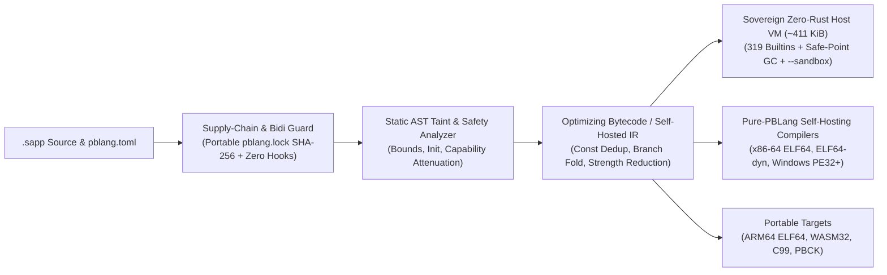

<div align="center">


# PBLang `2.6.0`

**Sovereign Zero-Rust Universal Programming Language (`64-bit · 32-bit · 16-bit · 8-bit · WASM`), `~415 KiB` Host Runtime, Complete `MSC2020 (00–97)` Interactive Mathematics, Universal 10-Domain Concept Cards, Symbolic 9D SI & Buckingham $\Pi$ Engine, Flagship Suites & `0D–ND` Omni-Dimensional Grapher (`69,700+` LOC · `63` MSC2020 Divisions · `25` Macro-Branches · `161+` Subcategories) & Omni-Polyglot Engine (`1940s–Futuristic`).**  
*Write `.sapp` programs targeting newest-to-oldest devices across 80 years of computing: the `~415 KiB` Linux / `~420 KiB` Windows / `~565 KiB` WASI-WASM Zero-Rust sovereign VM (`0` Rust dependencies), 32-bit `x86`/`ARMv7`/`ARMv6`/`MIPS`/`PowerPC`/`RISC-V` systems, 3-stage self-hosting pure-PBLang native compilers (`x64`, `x64-dyn`, `pe64`, `arm64`, `wasm`, `x86` ELF32, `pe32`, `rv32`, `dos16` 8086, `cpm80` 8080/Z80, `c64` 6502, `avr8` ATmega328P), freestanding `10.35 KiB` 8/16/32-bit MCU VM, **Complete `MSC2020 (00–97)` Sovereign Universal & Interactive Mathematics (`stdlib:mathematics.sapp` — Universal 10-Domain Interactive Concept Cards (`SVG` & `BMP`), Symbolic 9D SI + Currency + Information Algebra & Exact $\mathbb{Q}$ Buckingham $\Pi$ Solver, custom functions & autonomous real-time sliders, PhotoMath 2D OCR & 3-method tutor, GeoGebra/Desmos, MATLAB/Control/Simulink, Mathematica symbolic rewriting, `0D–ND` Omni-Dimensional Grapher & 7-Tab Native `gfx*` Math Studio, Risch–Bronstein–Liouville integration, all 7 indeterminacies, Galois $S_5$, Gröbner bases, $\mathbb{Z}$-Homology, Symbolic Einstein Tensors, Itô SDEs & World Canon)**, and **Omni-Polyglot `@<lang>` blocks across 124+ programming & non-programming languages**.*

[](https://github.com/PanosBiazis/pblang/releases/tag/v2.6.0)
[](LICENSE)
[](#universal-newest-to-oldest-device-matrix-v260)
[](#a0-sovereign-universal-mathematics--symbolic-cas-stdlibmathematicssapp)
[](#a-omni-polyglot-across-all-eras-programming--non-programming)
[](#architecture--implemented-surface)
[](SECURITY.md)

[Quick Start](#quick-start) · [Universal Devices (`64/32/16/8-bit`)](#universal-newest-to-oldest-device-matrix-v260) · [Why PBLang?](#why-pblang) · [Examples](examples) · [Documentation](docs/README.md) · [Tests](tests/README.md) · [Security Policy](SECURITY.md) · [Changelog](CHANGELOG.md) · [Releases](https://github.com/PanosBiazis/pblang/releases)

</div>

---

## Universal Newest-to-Oldest Device Matrix (`v2.6.0`)

Every release of `PBLang 2.6.0` ships **verified standalone executables, static zero-GLIBC bundles, freestanding MCU firmware, and retro executables** spanning modern 64-bit AI workstations down to 32-bit PCs/routers/SBCs, 16-bit MS-DOS/FreeDOS, and 8-bit microcontrollers/home computers — built reproducibly via PBLang's `@polyglot` engine (`tools/build_universal_devices.sapp`):

| Era / Word Width | Target Systems & Devices | Release Executables / Packages | Direct `pblang build --target` |
| :--- | :--- | :--- | :--- |
| **Newest 64-bit Desktop, Cloud, AI-PC & Mobile** | Linux `x86_64` & `ARM64` (dynamic + static `musl`), Windows 11 `x86_64` & `ARM64` (Snapdragon/Copilot+), macOS Universal (`Apple Silicon` + `Intel` fat Mach-O), Android `ARM64`/`x86_64`, FreeBSD `x86_64`/`ARM64`, Linux `RISC-V 64`, `LoongArch64`, `PowerPC64LE`, `IBM s390x` | `pblang-2.6.0-linux-{x86_64,arm64,riscv64,workstation-alt64}.tar.gz`, `pblang-2.6.0-windows-{x86_64,arm64}.zip`, `pblang-2.6.0-macos-universal.tar.gz`, `pblang-2.6.0-android-arm64-x86_64.tar.gz`, `pblang-2.6.0-freebsd-x86_64-arm64.tar.gz` | `--target x64`, `x64-dyn`, `pe64`, `arm64`, `pbck` |
| **Universal Web & Edge WASI (`32-bit` Linear Memory)** | Browser, Node.js WASI, `wasmtime`, `wasmer`, Cloudflare/Edge workers (`~565 KiB` full Sovereign `.sapp` compiler + VM in `pblang-2.6.0-wasm32.wasm`) | `pblang-2.6.0-wasm32.wasm`, `pblang-2.6.0-wasm32.tar.gz` | `--target wasm` |
| **`32-bit` Older PCs, SBCs, Routers & Bare-Metal MCUs** | Windows XP/7/8/10 `32-bit i686` (`PE32`), older 32-bit Linux `i386/i686` (`ELF32` static `musl`), Raspberry Pi 1/Zero (`ARMv6` soft-float `armel`) & Pi 2/3 (`ARMv7` `armhf`), OpenWrt `MIPS32`/`MIPSEL`, `PowerPC 32`, `RISC-V 32`, `ARM Cortex-M0/M4` & `ESP32` | `pblang-2.6.0-windows-x86.{exe,zip}`, `pblang-2.6.0-linux-x86{,.tar.gz}`, `pblang-2.6.0-linux-armv7{,-armel.tar.gz}`, `pblang-2.6.0-linux-routers-classic32.tar.gz`, `pblang-2.6.0-mcu-32bit-cortexm-rv32.tar.gz` | `--target x86` (`ELF32`), `--target pe32` (`.exe`), `--target rv32` (`RV32IM`) |
| **`16-bit` & `8-bit` Retro Systems & Microcontrollers** | `16-bit 8086` MS-DOS / FreeDOS (`pblang16.com`), `8-bit Intel 8080 / Z80` CP/M-80 (`pblang80.com`), `8-bit MOS 6502` Commodore 64 (`pblang64.prg`), `8-bit Atmel AVR ATmega328P` Arduino Uno (`10.35 KiB` Flash `.pbck` Micro-VM + `.hex`) | `pblang-2.6.0-legacy-8bit-16bit.zip` (`runtime_stage3/pblang_micro_vm.c` + `pblang_dos16_vm.asm`) | `--target dos16`, `--target cpm80`, `--target c64`, `--target avr8` |

---

## Why PBLang?

**PBLang (`2.6.0`, Edition 2026)** achieves 100% independence from any Rust runtime or toolchain across **64-bit, 32-bit, 16-bit, 8-bit, and WebAssembly** systems: it pairs a **`~415 KiB` Linux / `~420 KiB` Windows / `~565 KiB` WASI Sovereign Zero-Rust Host VM & `.sapp` Compiler (`runtime_stage3/`, 319 builtins)** with **pure-PBLang native machine-code compilers** (`64-bit` self-hosting `ELF64`/`PE32+`/`ARM64` + `<= 32-bit` `ELF32`/`PE32`/`RV32IM`/`8086`/`8080`/`6502`/`AVR8`), a **`10.35 KiB` freestanding `.pbck` Micro-VM** (`pblang_micro_vm.c`), a **Complete `MSC2020 (00–97)` Sovereign Universal & Interactive Mathematics Suite (`69,700+` LOC across all `63` active MSC2020 divisions, `25` macro-branches & `161+` subcategories)**, **Sovereign Omni-Polyglot (`1945 Plankalkül` to Futuristic Quantum/DNA/Photonic/Reversible/ZK + Non-Programming Languages)**, an **explainable `8/16/32/64-bit` Hardware & Math Resource Governor**, **Sovereign Studio UI**, and scientific/quantum/PQC modules:

| Pillar | Capability Highlights | Key Modules |
| :--- | :--- | :--- |
| **1. Sovereign Zero-Rust Universal Host VM & Compiler (`64-bit`, `32-bit` & `WASM32`)** | Complete C99 `.sapp -> .pbck` v1 compiler, SHA-256 disk bytecode cache, `O(1)` FNV-1a maps, 32-bit (`512 KiB`) & 64-bit (`2 MiB`) adaptive GC, 319 builtins, freestanding `10.35 KiB` `8/16/32-bit` `.pbck` Micro-VM (`pblang_micro_vm.c`), and polymorphic `pblang update`. | `runtime_stage3/pblang_zero_rust_vm.c`, `runtime_stage3/pblang_micro_vm.c`, `runtime_stage3/pblang_dos16_vm.asm` |
| **2. Pure-PBLang `64-bit -> 8-bit` Native Machine-Code Compilers (`0` Rust & `0` C)** | Self-hosting `x86-64` `ELF64` (`stage2 == stage3 == 55,272 B`), `x64-dyn`, Windows `PE32+`, `ARM64`, `WASM`, **plus direct `<= 32-bit` native emitters**: `32-bit i386 ELF32` (`x86`), `32-bit Windows PE32` (`pe32`), `32-bit RISC-V RV32IM` (`rv32`), `16-bit 8086 DOS .COM` (`dos16`), `8-bit CP/M-80 .COM` (`cpm80`), `8-bit 6502 C64 .PRG` (`c64`), and `8-bit AVR Intel HEX` (`avr8`). | `stdlib/native/codegen_x64.sapp`, `stdlib/native/codegen_sub32.sapp`, `stdlib/native/codegen_pe64.sapp`, `tools/pbc.sapp` |
| **3. Omni-Polyglot Engine (`1945–Futuristic` Programming & Non-Programming) + Hardware Governor** | `@<lang>` syntax across **124+ canonical families (`340+` IDs/aliases)**: `45+` pure-PBLang zero-subprocess evaluators (`@math`/`@wolfram`/`@maxima`, `Plankalkül`, `FORTRAN`, `LISP`, `COBOL`, `ALGOL-60`, `APL`, `BASIC`, `Forth`, `Pascal`, `Prolog`, `SQL`, `YAML`, `TOML`, `LaTeX`, `PostScript`, `G-code`, `Verilog`, `SPICE`, `ABC-Music`, `OpenQASM 3.0`, `FASTA/CRISPR`, `DNA-DSD`, `SMILES`, `SNN`, `Photonic MZI`, `Janus`, `ZK-R1CS`, `Cellular`) + fail-closed hash-bound host bridges (`75+` compilers/interpreters) + `8/16/32/64-bit` Hardware Governor. | `stdlib/polyglot_universal.sapp`, `stdlib/polyglot.sapp`, `stdlib/polyglot_registry.sapp`, `stdlib/hardware_governor.sapp` |
| **4. Usable `--sandbox` & Native TLS 1.3 / WinHTTP** | `pblang run script.sapp --sandbox` permits canonicalized, traversal-safe `stdlib:...` imports while denying ambient filesystem, network, HTTP, SQLite, FFI, subprocess, spawn, and env access; dynamic OpenSSL TLS 1.2/1.3 & Windows `WinHTTP` HTTPS with SSRF cloud-metadata blocking. | `runtime_stage3/zr_net_http_tls.h`, `stdlib/tls.sapp` |
| **5. Safe Linux Descriptor-Anchored File & Process Ops** | Race-resistant directory-descriptor file operations (`openat` / `O_NOFOLLOW`, `stdlib/linux_dirfs.sapp`, `stdlib/secure_file.sapp`), `pidfd` signaling (`stdlib/linux_pidfd.sapp`), and shell-free `execve` process supervision (`stdlib/linux_process.sapp`). | `stdlib/secure_file.sapp`, `stdlib/linux_dirfs.sapp`, `stdlib/linux_process.sapp` |
| **6. Deterministic Hardware Emulators & Embedded AVR8** | Pure-PBLang register-level device emulators (`Arduino Uno R4 WiFi`, `ESP32-D`, `Bosch BME688`, `3D Printer/CNC G-code`, `NFC/BLE`, `Stylus/TouchBoard`) and direct ATmega328P AVR8 firmware emission. | `emulators/hardware_emulators_suite.sapp`, `stdlib/embedded.sapp` |
| **7. Zero-Trust Security & Post-Quantum Cryptography** | Capability-gated FFI/FS/Net/Exec, default-on static build security analysis, NIST FIPS 202 `SHA-3`/`SHAKE` & FIPS 203 `ML-KEM-768` (`stdlib/pqc_mlkem768.sapp`), OpenBSD `$2b$` Bcrypt, RFC 7636 OIDC/SSO PKCE, and AES-256-GCM archives. | `stdlib/pqc_mlkem768.sapp`, `stdlib/tls.sapp`, `stdlib/password_bcrypt.sapp`, `stdlib/secure_archive.sapp` |
| **8. Complete `MSC2020 (00–97)` Sovereign Mathematics (`69,700+` LOC · `63` Divisions), Universal Concept Cards, Symbolic SI & `0D–ND` Studio** | Universal 10-Domain Interactive Concept Cards (`SVG` & `BMP`), Symbolic 9D SI + Currency + Information Algebra & Exact $\mathbb{Q}$ Buckingham $\Pi$ Solver (`universal_concept_cards.sapp`), custom functions & autonomous real-time slider lab (`interactive_lab.sapp`), PhotoMath 2D OCR & 3-method tutor, GeoGebra/Desmos, MATLAB/Control/Simulink, Mathematica symbolic rewriting (`flagship_suites.sapp`), `0D–ND` Omni-Dimensional SVG/BMP/Live Grapher (`omni_dimensional_grapher.sapp`), 7-Tab Native `gfx*` Math Studio (`native_math_studio.sapp`), Risch–Liouville integration, all 7 indeterminacies, Galois $S_5$, Gröbner bases, $\mathbb{Z}$-Homology, Symbolic Einstein Tensors, Itô SDEs & World Canon (`stdlib/mathematics.sapp`), plus `1..20`-qubit simulator (`stdlib/quantum_computing.sapp`). | `stdlib/mathematics.sapp`, `stdlib/math/`, `stdlib/algorithms_24.sapp`, `stdlib/quantum_computing.sapp` |
| **9. Smart Polymorphic `pblang update`, Portable Lockfiles, IDE & LSP** | Zero-Rust polymorphic `pblang update` (`runtime_stage3/zr_smart_updater.h`, `stdlib/smart_updater.sapp`), portable relative `pblang.lock` resolution, Native IDE (`pblang --ide`, `F7` Math/SI Inspector), Sovereign Studio (`pblang studio`), and linter/formatter. | `runtime_stage3/zr_smart_updater.h`, `stdlib/smart_updater.sapp`, `editors/ide/pbide.sapp` |
| **10. Binary Inspection & Unicode/Supply-Chain Guards** | Pure-PBLang ELF64/ELF32/PE32+/PE32/Mach-O/WASM format inspectors (`stdlib/rea_suite.sapp`), Trojan Source Bidi & invisible Unicode scanners (`stdlib/parseltongue.sapp`), and hermetic zero-hook manifests. | `stdlib/rea_suite.sapp`, `stdlib/parseltongue.sapp`, `stdlib/safety_guard.sapp` |

---

### Feature Showcases

#### A0. Sovereign Universal Mathematics & Symbolic CAS (`stdlib:mathematics.sapp`)
Covering all **`63` active `MSC2020` divisions (`00`–`97`)** (`69,700+` LOC pure PBLang, zero network I/O, governed by `AdaptiveMathGovernor`): Universal 10-Domain Interactive Concept Cards (`SVG` & `BMP`), Symbolic 9D SI + Currency + Information Algebra & Exact $\mathbb{Q}$ Buckingham $\Pi$ solver, custom multivariable/piecewise/recursive functions & Lagrange prime derivatives `f'(x)`, autonomous real-time variable sliders, PhotoMath 2D OCR & 3-method tutor, GeoGebra/Desmos, MATLAB/Simulink, Mathematica symbolic rewriting, `0D–ND` Omni-Dimensional Grapher (`SVG`, `24-bit BMP`, `play_live`, 7-Tab Native `gfx*` Math Studio), Risch–Bronstein–Liouville integration, all 7 indeterminacies, Galois $S_5$, Gröbner bases, $\mathbb{Z}$-homology, and symbolic Einstein/Ricci tensors:

```pblang
let MATH = import("stdlib:mathematics.sapp");

MATH.define_function("wave(x, t) = exp(-0.1*x^2) * cos(3*x - 2*t)");
let si_re = MATH.analyze_dimensions("(rho*v*L)/mu", map{ rho: "kg/m^3", v: "m/s", L: "m", mu: "Pa*s" });
let pi_gr = MATH.buckingham_pi("F_D:N, rho:kg/m^3, v:m/s, D:m, mu:Pa*s"); // 2 dimensionless Pi groups!
let card  = MATH.render_universal_concept_card_svg("y'' + 2*y' + 5*y = 0");
let risch = MATH.risch_integrate("exp(-x^2)", "x");      // sqrt(pi)*erf(x)/2 (verified by symbolic diff!)
let ineq  = MATH.solve("(x^2 - 4)/(x - 1) <= 0");        // (-∞, -2] ∪ (1, 2] (pole x=1 strictly open!)
assert(si_re.is_dimensionless and pi_gr.num_pi_groups == 2 and len(card) > 1000 and ineq.unicode == "(-∞, -2] ∪ (1, 2]");
```

#### A. Omni-Polyglot Across All Eras — Programming & Non-Programming (`stdlib:polyglot.sapp`)
Embed `@<lang>` blocks from 1945 (`@plankalkul`, `@fortran`, `@lisp`, `@cobol`), mathematical CAS (`@math`, `@wolfram`, `@maxima`), non-programming notations (`@g-code`, `@verilog`, `@spice`, `@latex`, `@postscript`, `@abc-music`), and futuristic paradigms (`@openqasm`, `@fasta`, `@smiles`, `@janus`, `@zk-r1cs`) and execute them safely in-memory via `POLY.eval_block` (plus pre-flight auditing via `stdlib:polyglot_guard.sapp`):

```pblang
let POLY = import("stdlib:polyglot.sapp");

@plankalkul [name="zuse_1945"] { V0 => Z0; Z0 * Z0 => R0 }
@openqasm [name="bell_pair"] { OPENQASM 3.0; qubit[2] q; h q[0]; cx q[0], q[1]; }
@g-code [name="cnc_cut"] { G21 G90 G1 X10 Y20 Z0.2 E1.5 F1200 }

let pk = POLY.eval_block(__polyglot.by_name["zuse_1945"], [9]);
let qm = POLY.eval_block(__polyglot.by_name["bell_pair"]);
let gc = POLY.eval_block(__polyglot.by_name["cnc_cut"]);
assert(pk.result == 81 and qm.probabilities["00"] > 0.49 and gc.ok == true);
```

#### B. Compiler-Integrated Taint, Unicode & Supply-Chain Defense
PBLang checks SQL/Command/Path taint flows, flags Trojan Source Bidi overrides (`CVE-2021-42574`) and invisible Unicode tags, and enforces capability-attenuated manifests:

```pblang
let PARSEL = import("stdlib:parseltongue.sapp");
let SAFETY = import("stdlib:safety_guard.sapp");

let scan = PARSEL.inspect_text(" normal_ident\u{202E}evil ");
print scan.clean; // false — Trojan Bidi override caught!

let report = SAFETY.verify_full_memory_and_general_safety();
print report.ok;  // true
```

#### C. Out-of-the-Box TLS 1.3 & Usable `--sandbox`
Run pure `.sapp` programs safely with `--sandbox` (trusted `stdlib:...` imports enabled; host I/O, traversal, FFI, and subprocesses denied), or establish TLS 1.3 listeners/connections directly via `stdlib:tls.sapp`:

```pblang
// Runs cleanly under: pblang run math_demo.sapp --sandbox
let math = import("stdlib:math.sapp");
print math.abs(-42);
```

#### D. Binary Format Auditing & CFG Reconstruction (`stdlib:rea_suite.sapp`)
Inspect ELF64, PE32+, Mach-O 64, and WASM headers and reconstruct basic control-flow graphs in pure `.sapp`:

```pblang
let REA = import("stdlib:rea_suite.sapp");

let audit = REA.rea_binary_audit(map{ format: "ELF64", arch: "x86_64", wx_enforced: true });
let cfg   = REA.rea_decompile_cfg(map{ instructions: ["push rbp", "mov rbp, rsp", "xor eax, eax", "pop rbp", "ret"] });
print cfg.pseudocode;
```

#### E. Quantum Circuits, Post-Quantum `ML-KEM-768` & Bioinformatics (`stdlib:quantum_computing.sapp`, `stdlib:pqc_mlkem768.sapp`)
Simulate exact statevectors, run Grover's search or Ising VQE (with OpenQASM 3.0 / Cirq export and optional IBM/Google QPU submission), and establish NIST FIPS 203 `ML-KEM-768` post-quantum shared secrets:

```pblang
let QC  = import("stdlib:quantum_computing.sapp");
let PQC = import("stdlib:pqc_mlkem768.sapp");

let grover = QC.grover_search(4, 11, nil);
assert(grover.top_state == 11 and grover.target_probability > 0.95);

let kp  = PQC.mlkem768_keygen("000102030405060708090a0b0c0d0e0f101112131415161718191a1b1c1d1e1f202122232425262728292a2b2c2d2e2f303132333435363738393a3b3c3d3e3f");
let enc = PQC.mlkem768_encaps(kp.ek_hex, "fedcba9876543210fedcba9876543210fedcba9876543210fedcba9876543210");
let dec = PQC.mlkem768_decaps(kp.dk_hex, enc.ct_hex);
assert(dec.shared_secret_hex == enc.shared_secret_hex);
```

---

## Architecture & Implemented Surface

### Primary Production Surface (`2.0.0` Sovereign Zero-Rust)

- **Sovereign Zero-Rust Cross-Platform Host VM & `.sapp` Compiler (`runtime_stage3/pblang_zero_rust_vm.c`, `~411 KiB` Linux `ELF64` / `~416 KiB` Windows `PE32+`)**: Complete C99 `.sapp -> .pbck` v1 compiler, SHA-256 disk bytecode cache, `O(1)` FNV-1a maps, closures & lexical upvalue cells, structured `try`/`catch`/`defer` unwinding, bytecode safe-point adaptive mark-and-sweep GC, 319 host builtins (SQLite, OpenSSL/WinHTTP HTTPS, X11+FreeType2/Win32GDI GUI, FFI, BigInt/Rational/Decimal), Zero-Rust polymorphic `pblang update` (`zr_smart_updater.h`), and `PBLZREXE` single-file standalone executable bundling — **zero Rust crates or toolchain required** (`crates/` retained solely as optional legacy reference).
- **Pure-PBLang 3-Stage Self-Hosting Native Compilers (`stdlib/native/codegen_x64.sapp`, `elf_dyn_x64.sapp`, `codegen_pe64.sapp`)**: Self-hosting Linux `x86-64` `ELF64` compiler (`stage2_elf == stage3_elf == 55,272 B` fixed-point with Cheney GC + `MADV_DONTNEED`, closures, hash maps, `try/catch/throw`), dynamic `ELF64` OS FFI (`--target x64-dyn`), and Windows 11 `PE32+` `.exe` compiler (`--target pe64`) with **zero `rustc` and zero `gcc`**.
- **Explainable Multi-Accelerator Hardware Governor & Sovereign Studio UI (`stdlib/hardware_governor.sapp`, `stdlib/sovereign_studio_ui.sapp`)**: Probes `CPU` SIMD, `RAM` pressure, `Storage`, `GPU`, `NPU`, `TPU`, battery/AC, and peripherals; governs workers, GC watermarks, Sparse-Hive LRU budgets, and zero-idle frame pacing (`pblang studio`, `pblang studio --export-html <file>`).
- **Smart Polymorphic `pblang update` & Portable Relative Lockfiles (`runtime_stage3/zr_smart_updater.h`, `stdlib/smart_updater.sapp`)**: unified Zero-Rust updater across `self` release bundles, `stdlib` (with RFC 8032 Ed25519 signature verification), `pblang.toml` workspaces, standalone `.sapp`/`.pbck` artifacts, `.zip`/`.tar.gz`/`.tar` archives, and ELF/launcher executables with portable relative `pblang.lock` paths, `pblang-package-tree-v2` SHA-256 verification, atomic `.bak` rollback, and SSRF/privacy guards.
- **Parser, optimizing compiler (`stdlib/compiler/optimizer.sapp`), type checker, linter, formatter, Self-Healing Compiler Advisor, and CLI**.
- **Capability-based sandboxing & embedding controls** (`--sandbox` permits canonicalized, symlink-free `stdlib:...` imports while denying ambient FS, Net, HTTP, SQLite, FFI, subprocess, spawn, and env access).
- **TLS 1.3 (OpenSSL / WinHTTP) & Post-Quantum Cryptography (`stdlib:pqc_mlkem768.sapp`)**: dynamic TLS 1.2/1.3 & HTTPS alongside pure-PBLang NIST FIPS 202 `SHA-3`/`SHAKE` and FIPS 203 `ML-KEM-768` key encapsulation.
- **Scientific, Algorithmic, Quantum & Bioinformatics Modules**: 24 first-principles algorithms + topological Betti invariants + portfolio meta-solver (`stdlib:algorithms_24.sapp`), `1..20`-qubit statevector simulator + Grover/VQE + OpenQASM 3.0/Cirq + IBM/Google Quantum cloud REST clients (`stdlib:quantum_computing.sapp`), and Needleman-Wunsch / Smith-Waterman / ORF / De Bruijn assembly (`stdlib:bioinformatics_dna.sapp`).
- **Default-on PBLang-native build security analysis** with audited scoped suppressions, `protect`/`strict`/`audit` modes, bounded custom rules, and an explicit opt-out. Selectable quality/performance/completeness analysis is available separately through `pbanalyze`; see [source security and analysis](docs/Security_Analysis.md).
- **Package manager** with manifests (`pblang.toml`), portable relative content-addressed lockfiles (`pblang.lock`), SPDX license compatibility checks, 3-color DFS cycle detection, and publisher release attestations.
- **Standard library** for files, paths, JSON, strings, arrays, maps, HTTP helpers, bounded memory/SQLite/Redis data stores, provider-neutral edge/regional CDN caching, native SQLite, bounded native Parquet metadata/PLAIN-page reading, crypto, threading, async-style helpers, testing, templates, logging, regex, tensors, and more. `stdlib:onnx.sapp` provides bounded deterministic ONNX protobuf decoding and PBLang-native CPU inference for a documented operator subset, failing closed on unsupported models without Python or ONNX Runtime. `stdlib:command_argv.sapp` converts legacy command text to bounded literal argv without shell evaluation and rejects operators, redirects, substitutions, comments and controls; new APIs should accept structured argv directly. See [data storage](docs/Data_Storage.md) and [CDN caching](docs/CDN_Caching.md).
- **Portable coding-agent skills** through `stdlib:agent_skills.sapp`: bounded `SKILL.md` frontmatter/body parsing, strict portable names and metadata, compatibility reports, effect-indicator review, and deterministic in-memory bundles. It performs no discovery, file access, placeholder expansion, plugin loading, hook registration, or command execution.
- **Bounded identity and organization policy** through `stdlib:iam.sapp`: users, organizations, memberships, system administrators, `owner`/`admin`/`member`/`viewer` RBAC, explicit permissions, tenant-scoped queries, and last-owner/last-admin invariants.
- **PBLang-native Linux x86-64 process supervision** through `stdlib:linux_process.sapp`: direct `execve(argv)` without shell parsing, private process groups, wall/address-space limits, an independent 64 MiB child-file ceiling, separately bounded retained stdout/stderr, asynchronous `start/poll/cancel/finish`, descriptor-held fixed executable fallback through `run_fixed`, and verified process-group termination. See `examples/bounded_process/main.sapp`.
- **Strict cron expressions** through `stdlib:cron.sapp` and **carrier-independent transport guard** through `stdlib:transport_security.sapp`.
- **Native pblang IDE & Sovereign Studio** via `pblang --ide` and `pblang studio`: code editor, Rope buffer & symbol indexer, hardware governor telemetry, visual designer, optional pbAI panel (external [pbai](https://github.com/PanosBiazis/pbai) checkout via `PBAI_HOME`), and pblang-native browser panel.
- **Self-hosted compiler pipeline & native codegens** under `stdlib/compiler/` and `stdlib/native/` (`optimizer.sapp`, `codegen_x64.sapp`, `elf_dyn_x64.sapp`, `codegen_pe64.sapp`, `codegen_x64_tier1.sapp`, `codegen_arm64_ast.sapp`, `codegen_wasm.sapp`, `ctranspile.sapp`).

### Reproducible Live Benchmarks vs. Synthetic Catalog Models

PBLang strictly separates **live OS process benchmarks** from **synthetic architectural models**:

- **Live Process Benchmark Harness (`stdlib/repro_benchmark.sapp`, `bench/reproducible_core_matrix.sapp`)**:
  - Measures real subprocess execution via `timeout` + GNU `time`, verifying stdout checksums and recording cold/warm wall time, user/system CPU time, peak RSS, and artifact size.
  - Evaluates **4 distinct PBLang execution paths** honestly alongside installed system toolchains (`c`, `cpp`, `rust`, `go`, `java`, `csharp`, `python`, `javascript`, `zig`):
    1. `pblang-interpreter`: runs `.sapp` source directly on the `pblang` bytecode VM (no hidden AOT binary substitution).
    2. `pblang-c99`: measures both `.sapp -> .c` transpilation and `gcc -O3` compilation without cross-run object caching, then benchmarks the native binary.
    3. `pblang-codegen-x64` & `pblang-tier1-x64`: measures native Linux `x86-64` ELF64 compilation in the compile phase, then benchmarks the standalone ELF64 binary.
- **Synthetic Catalog Models (`stdlib/omni_bench.sapp`, `stdlib/pblang_omni_supremacy_engine.sapp`)**:
  - Analytical/catalog models explicitly tagged with `measured_live: false` and `mode: "synthetic_catalog_model"` (and marked `status: "synthetic_model"` in `repro_benchmark.coverage()`).

```bash
pblang run bench/reproducible_core_matrix.sapp --allow-all
pblang run tests/omni_bench_test.sapp --allow-all
pblang run tests/safety_test.sapp --allow-all
```

### Memory Safety, General Safety & Supply-Chain/Toolchain Defense (`stdlib/safety_guard.sapp`)

- **Spatial Memory Safety**: Bounds-checked array/slice/buffer indexing (`0 <= idx < len`), strict `W^X` (`0` RWX segments across emitted ELF64, PE32+, Mach-O 64, and WASM32), and `NX_COMPAT` non-executable stack.
- **Temporal Memory Safety**: Safe-point adaptive mark-and-sweep GC in the Zero-Rust VM, Cheney 2-space copying GC + `MADV_DONTNEED` in native `x86-64` codegen, and deterministic `defer` file-descriptor/handle cleanup.
- **Arithmetic & Generalized Reciprocal Safety**: Division/modulo-by-zero checks (`ud2` / `pb_div_checked` / `pb_mod_checked`), `INT64_MIN / -1` signed overflow protection, and Barrett/Granlund-Montgomery reciprocal multiplication for constant moduli.
- **Supply-Chain & Toolchain Defense (`stdlib/manifest_validate.sapp` + `stdlib/safety_guard.sapp`)**:
  - **Zero-Install-Hook Hermetic Manifests**: Rejects `[scripts]`, `[hooks]`, `preinstall`, `postinstall`, and `build_script` hooks in `pblang.toml`.
  - **Trojan Source (`CVE-2021-42574`) Blocker**: Rejects Unicode Bidi override characters (`U+202A..U+202E`, `U+2066..U+2069`) before tokenization.
  - **Typosquatting, Capability Attenuation & Content-Addressed Lockfiles (`pblang-package-tree-v2`)**: Enforces SHA-256 package tree verification and blocks path traversal.

---

## Compilation & Security Pipeline



## Repository Directory Map

| Directory | Contents & Guide |
| :--- | :--- |
| [`runtime_stage3/`](runtime_stage3) | **Sovereign Zero-Rust Host Runtime & `.sapp` Compiler (`v2.0.0`)** — Cross-platform C99 VM, compiler, SHA-256 `.pbck` cache, SQLite, OpenSSL/WinHTTP, X11/Win32GDI (`pblang_zero_rust_vm.c`, `zr_*.h`). |
| [`stdlib/`](stdlib) | Self-hosted standard library, 3-stage self-hosting `x64`/`ELF64-dyn`/`PE32+`/`ARM64`/`WASM`/`C99` compilers (`stdlib/compiler/`, `stdlib/native/`), hardware governor (`hardware_governor.sapp`), Sovereign Studio (`sovereign_studio_ui.sapp`), 24 algorithms (`algorithms_24.sapp`), quantum (`quantum_computing.sapp`), DNA (`bioinformatics_dna.sapp`), PQC (`pqc_mlkem768.sapp`), smart updater (`smart_updater.sapp`), UI (`modern_ui.sapp`), AI (`onnx.sapp`), crypto (`tls.sapp`), and safety (`safety_guard.sapp`). |
| [`docs/`](docs) | [Documentation Hub (`docs/README.md`)](docs/README.md) — Language reference, security/safety contracts, embedded/OS guides, and [`docs/reports/`](docs/reports). |
| [`examples/`](examples) | [Runnable Examples & Demos (`examples/README.md`)](examples/README.md) — `.sapp` examples across security, GUI/Web/Android, AI, and [`examples/demos/`](examples/demos). |
| [`bench/`](bench) | [Benchmark Suite (`bench/README.md`)](bench/README.md) — Live OS process matrix (`reproducible_core_matrix.sapp`) and synthetic catalog models (`omni_bench.sapp`). |
| [`tests/`](tests) | [Verification Suite (`tests/README.md`)](tests/README.md) — Zero-Rust VM (`zero_rust_vm_test.sapp`), Path B 3-stage self-hosting (`path_b_native_sovereign_test.sapp`), hardware governor & Studio UI (`hardware_governor_and_studio_ui_test.sapp`), smart updater (`smart_updater_test.sapp`), algorithms/quantum/DNA/PQC (`algorithms_quantum_pqc_bio_test.sapp`), and safety (`safety_test.sapp`). |
| [`emulators/`](emulators) | [Hardware Emulators (`emulators/README.md`)](emulators/README.md) — 6 deterministic register-level device emulators & hardware bus manager. |
| [`tools/`](tools) | [Toolchain Drivers (`tools/README.md`)](tools/README.md) — Self-hosted compiler (`pbc.sapp`), lock publisher (`pblock.sapp`), and security auditors (`pbsecure.sapp`, `pbaudit.sapp`). |
| [`src/`](src) & [`crates/`](crates) | Optional legacy reference bootstrap workspace (not required to build or run `pblang 2.0.0`). |

---

## Quick start

### Standalone Execution (Zero Rust Dependency)

Build the sovereign `pblang` binary in `< 10 s` with any standard C99 compiler (`gcc -O3 -std=gnu99 runtime_stage3/pblang_zero_rust_vm.c -ldl -lpthread -lm -s -o pblang` on Linux, or `x86_64-w64-mingw32-gcc` on Windows) — no Rust toolchain is required to build, run, check, test, or compile `.sapp` programs.

### Hello World

Create `hello.sapp`:

```pblang
print "Hello, World!";

fn add(a, b) {
    return a + b;
}

print add(2, 3);
```

Run, check, test, or launch the Sovereign Studio directly with `pblang`:

```bash
pblang run hello.sapp
pblang check hello.sapp
pblang doctor
pblang studio --export-html studio.html
```

### 100% PBLang Native Compilation (`x64`, `x64-dyn`, `pe64`, `arm64`, `wasm`, `pbck`)

`tools/pbc.sapp` compiles `.sapp` programs directly to standalone static Linux `x86-64` ELF executables, dynamic OS-FFI `ELF64` executables (`x64-dyn`), native Windows 11 `PE32+` `.exe` executables (`pe64`), `AArch64/ARM64` ELF executables, WebAssembly (`.wasm`), or `.pbck` bytecode using pure-PBLang code generators — with zero `rustc`/`cargo` or external C toolchain required:

```bash
pblang run tools/pbc.sapp --allow-all -- hello.sapp --target x64 --out hello
chmod +x ./hello && ./hello

pblang run tools/pbc.sapp --allow-all -- hello.sapp --target x64-dyn --out hello-dyn
pblang run tools/pbc.sapp --allow-all -- hello.sapp --target pe64 --out hello.exe
pblang run tools/pbc.sapp --allow-all -- hello.sapp --target arm64 --out hello-arm64
pblang run tools/pbc.sapp --allow-all -- hello.sapp --target wasm --out hello.wasm
pblang run tools/pbc.sapp --allow-all -- hello.sapp --target pbck --out hello.pbck
```


### One-line applications

The pblang-only `stdlib/app.sapp` facade builds CLI, native GUI, hardened web,
or composed full-stack
applications from one declarative entry point. A complete CLI application fits
on one physical source line:

```pblang
let app = import("stdlib/app.sapp"); app.run(map{ kind: "cli", handler: fn(ctx) { return "Hello from pblang"; } });
```

The compact helpers remove the envelope as well:

```pblang
import("stdlib/app.sapp").cli("Hello from pblang");
```

Use `kind: "gui"` with a `widgets` array, `kind: "web"` with `routes`, or
`kind: "fullstack"` with `cli`, `gui`, and `web` component maps. Full-stack
`start` explicitly selects the live blocking surface; the other surfaces use
their real preview builders.
`preview: true` builds and exercises the real form/router without opening a
window or socket. Runnable examples are under `examples/one_line_apps/` and are
included in the PBIDE Examples catalog.

For responsive, themeable applications, `stdlib/modern_ui.sapp` adds
row/column/grid/card layouts and modern controls while retaining access to the
lower-level GUI form:

```pblang
let ui = import("stdlib/modern_ui.sapp"); import("stdlib/app.sapp").surface("Tasks", ui.screen([ui.heading("Tasks"), ui.button("Add")]), map{ mode: "auto" });
```

The same validated view tree runs on native desktop and builds a signed Android
APK from PBLang-generated JVM bytecode and hardened responsive Web artifacts
through the same shared components and selectable `app.surface(...)` mode.
iOS, Web and embedded remain explicit adapter contracts and fail clearly until
their real runtimes are linked. Native `gui.button(...)` controls also accept
semantic `primary`, `secondary`, `navigation`, `ghost` and `danger` variants;
older calls remain primary by default and custom palettes can override the
corresponding selected, focus, danger and on-accent roles.
See [`docs/Visual_Designer.md`](docs/Visual_Designer.md).

### Native embedded programming

`stdlib/embedded.sapp` provides capability-checked portable GPIO/time IR,
board/MCU/architecture descriptors, deterministic circuit emulation, and a
native AVR8 backend. PBLang currently emits a compact ATmega328P firmware body
and Intel HEX directly, without a C/C++/Rust source fallback:

```pblang
let embedded = import("stdlib:embedded.sapp");
let firmware = embedded.build(embedded.blink("status-led-test", 500), "arduino-uno");
```

The ESP32 RAM-only GPIO23 blink path has physical timing evidence, while its
persistent/general backend and the RP2040/RP2350, Renesas and broader MCU
backends remain fail-closed. `pbembed manual`, `inspect`, and `inspect-pin`
publish technical data without confusing hardware capability with compiler
support. See [`docs/Embedded_Programming.md`](docs/Embedded_Programming.md) and
the runnable `examples/embedded_blink/`, `examples/embedded_circuit/`, and
`examples/embedded_inspector/`.

### One-line CDN-backed static site

The pure-PBLang CDN control layer combines a safe static origin with bounded
edge and regional caches, ETag/304 handling, SWR, stale-if-error, and purge:

```pblang
let site = import("stdlib:cdn_cache.sapp").static_site("public");
```

This is executable cache behavior for an edge/origin-shield process; actual
geographic POP deployment remains an infrastructure concern. See
[`docs/CDN_Caching.md`](docs/CDN_Caching.md) and `examples/cdn_cache/`.

### Self-hosted hosted C99

`stdlib/compiler/ctranspile.sapp` can now produce a complete userspace
translation unit and an optimized executable without using the Rust
transpiler:

```pblang
let c99 = import("stdlib/compiler/ctranspile.sapp");
let result = c99.build_program("fn sq(x) { return x*x; } print sq(9);", "square", map{ profile: "speed" });
```

`run_program(...)` adds a bounded watchdog and temporary-artifact cleanup.
Normal mode preserves f64 arithmetic. `numeric: "integer"` is explicit and
opt-in because integer division is not equivalent to normal pblang semantics.

Adapters load lazily by application kind. On the recorded development host,
twenty cold CLI processes fell from 1,182 ms with eager GUI/web imports to 77 ms
with lazy loading. Reproduce the warm component costs with
`pblang run bench/app_facade_stages.sapp --allow-all`.

For bounded Linux control-plane connections, `stdlib:native_tcp.sapp` provides
nonblocking IPv4 connect/accept/read/write deadlines, ephemeral listeners,
independently owned accepted sockets, close-on-exec descriptors and
binary-safe UTF-8 copying. Unsupported ABIs fail closed; this is not a TLS
layer. See [`docs/Protocols.md`](docs/Protocols.md) and [`docs/TLS_notes.md`](docs/TLS_notes.md).

---

## Common commands

| Command | Description |
|---|---|
| `pblang run <file\|dir> [--allow-all\|--sandbox]` | Execute a `.sapp` source file, `.pbck` bytecode file, or `pblang.toml` package on the Sovereign Zero-Rust VM. |
| `pblang <file\|dir>` | Short `run` alias; recognized source/bytecode paths execute directly without entering the REPL. |
| `pblang check <file>` | Parse and compile-verify `.sapp` syntax, bindings, and structure with zero execution side effects. |
| `pblang test [dir]` | Discover and execute `.sapp` verification suites. |
| `pblang doctor` | Inspect the Sovereign Zero-Rust host runtime, `stdlib` discovery, cache directory, and detected OS/hardware capabilities. |
| `pblang update [target]` | Polymorphic atomic updater across `self`, `pblang.toml` workspaces, `.sapp` scripts, and archives (`--dry-run`, `--rollback`, `--json`). |
| `pblang studio [--export-html <file>]` | Launch the WCAG AAA Obsidian/Alabaster Sovereign Studio native window or export a 100% offline self-contained HTML5 dashboard. |
| `pblang --ide` | Launch the native `pbIDE` editor & visual designer (`editors/ide/pbide.sapp`). |
| `pblang build <file> --bundle-exe -o <out>` | Package a `.sapp` program + precompiled `.pbck` into a standalone single-file Zero-Rust executable (`PBLZREXE`). |
| `pblang run tools/pbc.sapp --allow-all -- <src> --target <t> --out <out>` | Pure-PBLang compiler driver targeting `x64` (3-stage static `ELF64`), `x64-dyn` (dynamic OS-FFI `ELF64`), `pe64` (Windows 11 `PE32+` `.exe`), `arm64`, `wasm`, `c`, or `pbck`. |
| `pblang run tools/pbsecure.sapp --allow-all -- <src>` | Interprocedural semantic taint, sink, and capability policy analyzer. |
| `pblang run tools/pbaudit.sapp --allow-all -- --module-by-module --resume --json-output=audit.json <roots...>` | Atomic resumable per-module repository security and quality auditor. |
| `pblang run tools/pblock.sapp --allow-all -- <project>` | Validate `pblang.toml` and publish a portable relative `pblang.lock` (`pblang-package-tree-v2`). |
| `pblang fmt [files...]` | Format `.sapp` source files. |
| `pblang lint [files...]` | Parse, type-check, and lint `.sapp` source files. |
| `pblang lsp` | Start the Language Server Protocol (`LSP`) server. |

Large product test runners can use `stdlib:test_scheduler.sapp` and `stdlib:hardware_governor.sapp` to cap workers by CPU topology, battery/AC state, and available RAM. Warm `.pbck` caches accelerate repeated runs while invalidating automatically on any SHA-256 source change.

---

## Language overview

```pblang
let name = "Alice";
let nums = [1, 2, 3];
let config = map{host: "localhost", port: 8080};

fn greet(name) {
    return "Hello, " + name + "!";
}

if len(nums) > 0 {
    print greet(name);
}

for x in nums {
    print x;
}

let result = match 200 {
    case 200: "OK",
    case 404: "Not Found",
    case _: "Unknown"
};

print result;
```

Both the Sovereign Zero-Rust compiler (`runtime_stage3/zr_compiler.h`) and the pure-PBLang self-hosted compiler (`stdlib/compiler/parser.sapp`) support value-producing `elif` and `else if` chains:

```pblang
let class_name = if score >= 90 { "excellent" }
    elif score >= 75 { "good" }
    elif score >= 50 { "pass" }
    else { "retry" };
```

---

## Hardware Governor, Tensor Compute & Arbitrary-Width Floats

### Explainable Multi-Accelerator Hardware Governor (`stdlib/hardware_governor.sapp`)

`stdlib/hardware_governor.sapp` combines the Zero-Rust VM's native `hardware_probe()` builtin with cross-platform topology discovery (`Linux` `/proc` + `/sys` + `/dev/dri` + `/dev/accel*` and `Windows` Win32 memory/CPU APIs) to govern workloads across every computational resource:

```pblang
let HG = import("stdlib:hardware_governor.sapp");
let profile = HG.probe_system_topology();
let plan    = HG.govern_workload("ai_inference", map{ dataset_mb: 64, latency_sensitive: true });
print plan.explanation_el;
print plan.explanation_en;
```

- **Adaptive Resource Governance**: Dynamically tunes worker thread counts, safe-point GC high-watermarks, Sparse-Hive LRU cell budgets, and zero-idle UI frame pacing (`~0.0%` CPU when idle, `60/120 Hz` during active interaction).
- **Machine Inventory (`stdlib/hwinfo.sapp`)**: Vendor-agnostic device survey across CPU, RAM, NVMe/SSD/HDD storage, integrated & discrete GPUs, NPU (`/dev/accel*`), and peripherals (`hw.survey()`, `hw.compute_plan()`), reporting honestly which accelerators have active compute backends versus inventory/telemetry detection.

### Tensor Compute (`tensor_*` & `stdlib/onnx.sapp`)

- **Deterministic CPU Tensor Kernels (Default)**: Exact `f64` matrix multiplication and elementwise tensor ops with reproducible outputs across core counts, paired with pure-PBLang bounded CPU ONNX inference (`stdlib/onnx.sapp`) and Safetensors-to-GGUF v3 conversion (`stdlib/gguf.sapp`).
- **Optional Legacy `wgpu` Prototype**: The optional legacy Rust reference workspace (`crates/`) retains an opt-in `f32` `wgpu` shader path (`cargo build --release --features gpu` + `PBLANG_GPU=1`); the Sovereign Zero-Rust `2.0.0` binary keeps zero `wgpu`/Rust bloat (`~411 KiB` total binary size) and defaults to exact `f64` CPU execution. See [`docs/GPU_Stack.md`](docs/GPU_Stack.md).

### Arbitrary-Width Floats (`fN` — `stdlib/floatn.sapp`)

`stdlib/floatn.sapp` represents and quantizes floating-point formats of **any** bit width — `f0`, `f1`, `f2`, `f4`, `f8` (`f8e4m3`/`f8e5m2`), `f16`, `bf16`, `tf32`, `f32`, `f64`, `f128`, and custom `fN` — for low-bit ML weight packing and embedded targets:

```pblang
let F = import("stdlib:floatn.sapp");
F.quantize(3.14159, "bf16")             // 3.140625 (nearest bf16 value, as f64)
F.info("f8e4m3").max_finite             // 448
F.matmul(A, B, "f16")                   // emulated f16-rounded matmul
let bytes = F.pack(weights, "f8e4m3")   // 8x smaller than f64 on disk
```

---

## Project layout

```text
pblang/
├── runtime_stage3/              # Sovereign Zero-Rust Host VM & .sapp -> .pbck Compiler (v2.0.0)
│   ├── pblang_zero_rust_vm.c    # Cross-platform C99 entry, CLI, bundle runner (~411 KiB stripped)
│   ├── zr_vm_core.h             # 48-opcode stack VM, O(1) FNV-1a maps, closures, adaptive GC
│   ├── zr_compiler.h            # Native C99 Unicode lexer, parser & .pbck v1 compiler
│   ├── zr_loader.h              # Portable stdlib/pblang.lock discovery & SHA-256 .pbck cache
│   ├── zr_smart_updater.h       # Polymorphic atomic updater, ZIP/TAR delta sync & Ed25519 verify
│   ├── zr_net_http_tls.h        # POSIX/Winsock2 TCP, OpenSSL TLS 1.3, WinHTTP HTTPS, WebSocket
│   ├── zr_sqlite_ffi.h          # Dynamic libsqlite3 / winsqlite3.dll & capability-gated FFI
│   ├── zr_gfx.h                 # Native X11 + FreeType2 (Linux) & Win32 GDI (Windows) GUI
│   └── zr_{common,pbck_io,fs_os,json_crypto,builtins_core}.h
├── stdlib/                      # 100% Pure-PBLang Standard Library & Self-Hosted Compilers
│   ├── compiler/                # Self-hosted tokenizer, parser, optimizer, C99 & .pbck emitters
│   ├── native/                  # 3-stage self-hosting x64 ELF64, x64-dyn, Windows PE32+, ARM64, WASM
│   ├── hardware_governor.sapp   # Multi-accelerator CPU/RAM/GPU/NPU/TPU governor
│   ├── sovereign_studio_ui.sapp # WCAG AAA Obsidian/Alabaster native + HTML5 Studio
│   ├── smart_updater.sapp       # Polymorphic atomic updater & portable lockfile sync
│   ├── algorithms_24.sapp       # 24 canonical algorithms + portfolio meta-solver
│   ├── quantum_computing.sapp   # 1..20-qubit statevector simulator + IBM/Google QPU clients
│   ├── pqc_mlkem768.sapp        # NIST FIPS 202 SHA-3/SHAKE & FIPS 203 ML-KEM-768
│   └── bioinformatics_dna.sapp  # Needleman-Wunsch, Smith-Waterman, ORF & De Bruijn assembly
├── tools/                       # Pure-PBLang CLI drivers (pbc.sapp, pbsecure.sapp, pbaudit.sapp, pblock.sapp)
├── editors/                     # Native pbIDE (editors/ide/) & VS Code extension (editors/vscode/)
├── emulators/                   # 6 deterministic register-level hardware simulation models
├── tests/                       # Comprehensive .sapp verification & safety suites
├── bench/                       # Live OS process benchmarks & synthetic catalog models
├── examples/                    # Runnable .sapp demos across security, UI, AI, and embedded
├── docs/                        # Documentation hub, contracts, and benchmark/validation reports
└── src/ & crates/               # Optional legacy reference bootstrap workspace (not required in v2.0.0)
```

See [`docs/Lockfile_contract.md`](docs/Lockfile_contract.md) for portable `pblang.lock` (`pblang-package-tree-v2`) rules and [`docs/README.md`](docs/README.md) for the complete documentation index.

---

## Building from Source & Capability Sandboxing

### Building the Sovereign Zero-Rust Binary (`Linux` & `Windows`)

```bash
# Linux (x86-64 / ARM64 POSIX — produces ~411 KiB stripped ELF64):
gcc -O3 -std=gnu99 -Wall -Wno-unused-function \
  runtime_stage3/pblang_zero_rust_vm.c -ldl -lpthread -lm -s -o pblang

# Windows x86-64 (MinGW-w64 — produces ~416 KiB stripped PE32+ .exe):
x86_64-w64-mingw32-gcc -O3 -std=gnu99 -Wall -Wno-unused-function \
  runtime_stage3/pblang_zero_rust_vm.c -lws2_32 -lwinhttp -lgdi32 -luser32 -lbcrypt -s -o pblang.exe
```

### Capability-Sandboxed Execution

Run untrusted or pure-computation scripts under `--sandbox` (canonicalized `stdlib:...` imports allowed; filesystem, network, HTTP, SQLite, FFI, subprocesses, and environment mutations denied by default) or selective `--deny-*` / `--allow-*` flags:

```bash
pblang run script.sapp --sandbox
pblang run web_app.sapp --allow-net --deny-exec --deny-ffi
```

*(For host applications embedding the optional legacy Rust `pblang-vm` crate, see [`docs/Embedding.md`](docs/Embedding.md) and [`docs/Embedding_lifecycle.md`](docs/Embedding_lifecycle.md).)*

---

## Documentation

- **Documentation Hub**: [`docs/README.md`](docs/README.md)
- **Language Semantics & Pipeline**: [`docs/Language_Semantics.md`](docs/Language_Semantics.md) · [`docs/Execution_pipeline.md`](docs/Execution_pipeline.md) · [`docs/Executable_targets.md`](docs/Executable_targets.md)
- **Security, Safety & Capabilities**: [`SECURITY.md`](SECURITY.md) · [`docs/Safety.md`](docs/Safety.md) · [`docs/Security_Analysis.md`](docs/Security_Analysis.md) · [`docs/Capability_model.md`](docs/Capability_model.md) · [`docs/Lockfile_contract.md`](docs/Lockfile_contract.md)
- **Tooling, Studio UI & Performance**: [`docs/Tooling.md`](docs/Tooling.md) · [`docs/Visual_Designer.md`](docs/Visual_Designer.md) · [`docs/Performance_Contracts.md`](docs/Performance_Contracts.md) · [`docs/Benchmarking.md`](docs/Benchmarking.md)

---

## Testing

```bash
# Sovereign Zero-Rust VM, C99 .sapp compiler, SQLite, HTTP/TLS & single-file bundle:
./pblang run tests/zero_rust_vm_test.sapp --allow-all

# Pure-PBLang 3-Stage Self-Hosting Native Compilers (ELF64 fixed-point, x64-dyn, Windows PE32+):
./pblang run tests/path_b_native_sovereign_test.sapp --allow-all

# Multi-Accelerator Hardware Governor & Sovereign Studio UI:
./pblang run tests/hardware_governor_and_studio_ui_test.sapp --allow-all

# Smart Polymorphic `pblang update`, 24 Algorithms / Quantum / PQC, Safety & Release Readiness:
./pblang run tests/smart_updater_test.sapp --allow-all
./pblang run tests/algorithms_quantum_pqc_bio_test.sapp --allow-all
./pblang run tests/safety_test.sapp --allow-all
./pblang run tests/public_release_readiness_test.sapp --allow-all
```

---

## License

MIT. See [`LICENSE`](LICENSE).
