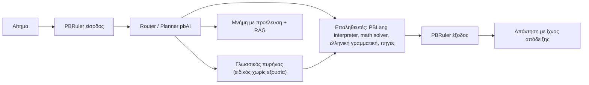

# pbAI: Όραμα, ιδέες και ειλικρινής κατάσταση (5 Νοεμβρίου 2026)

> **Προέλευση:** Το έγγραφο συγκεντρώνει τα μηνύματα του Panos για τα pbAI σε μία συζήτηση στο Antigravity (conversation `3ed4a119-7a9a-4ef2-9272-18257196ad9e`, 17 Οκτωβρίου – 5 Νοεμβρίου 2026), μαζί με την αποτίμηση που έδωσε ο βοηθός στις 5 Νοεμβρίου 2026.
>
> Τα μηνύματα είναι **περιληπτικές αποδόσεις**. Δεν πρόκειται για αυτούσια αποσπάσματα.
>
> Η συγκέντρωση έγινε με αναζήτηση λέξεων-κλειδιών. Βρέθηκαν 144 μηνύματα, που έγιναν 111 μετά την αφαίρεση των διπλότυπων. Μπορεί να λείπουν ιδέες που διατυπώθηκαν με άλλες λέξεις.
>
> Το έγγραφο καταγράφει **ιστορικό και πρόθεση**. Δεν αποτελεί απόδειξη ότι κάτι λειτουργεί.
>
> Ίδιο αρχείο υπάρχει σε δύο σημεία:
> - `pbai/docs/` (ανεξάρτητο pbAI)
> - `pblang/editors/ide/tools/ai/docs/` (ενσωματωμένο pbAI)

---

## Μέρος Α — Οι ιδέες και οι απαιτήσεις του Panos

### Α1. Γενικό όραμα
- Το pbAI πρέπει να λύνει τα προβλήματα των μεγάλων μοντέλων ΤΝ, και να είναι γραμμένο **μόνο σε PBLang**.
- Στόχος είναι να ξεπεράσει με διαφορά τον κορυφαίο ανταγωνιστή σε κάθε κατηγορία και τομέα, σε AI/LLM και σε MCP. **Δεν χρειάζεται να τους μοιάσει αρχιτεκτονικά.**
- Το προϊόν απευθύνεται σε όλο τον κόσμο, όχι μόνο στην cosmodata.
- *«Δεν χρειαζόμαστε τρισεκατομμύρια ή ίσως ούτε δισεκατομμύρια παραμέτρους αν γίνει σωστά. Η PBLang φτιάχτηκε όταν τα frontier μοντέλα έλεγαν ότι δεν γίνεται. Το ίδιο μπορεί να γίνει και με το pbAI.»* (3 Νοε)
- Γερά θεμέλια πρώτα. Βελτίωση ξεκινώντας από το **μικρότερο στοιχείο**, τον νευρώνα και τη σύναψη.

### Α2. Δύο προϊόντα
| | Ενσωματωμένο pbAI (μέσα στην PBLang / pbIDE) | Ανεξάρτητο pbAI (repo `pbai`) |
|---|---|---|
| Γλώσσα | **Μόνο αγγλικά** | Πολλές γλώσσες, όλα τα θέματα της ζωής |
| Κύρια χρήση | **Παραγωγή κώδικα PBLang**, σύγκριση με μοντέλα τύπου Claude | Γενικός βοηθός: θέμα και ειδίκευση προκύπτουν από τη συζήτηση |
| Πολυτροπικότητα | Πολυτροπική είσοδος και έξοδος | Κείμενο, εικόνα, βίντεο, ήχος και ζωντανός διάλογος |
| Αρχιτεκτονική | Ελαφρύτερη | **Διαφορετική αρχιτεκτονική και λογική.** Πολλά μοντέλα και υπομοντέλα, με έναν ενορχηστρωτή ανά κατηγορία και υποκατηγορία. Περιλαμβάνει τοπολογικές ιδέες |
| Εκπαίδευση | Λίγο λιγότερη | Περισσότερη, με τα δικά μας εργαλεία και με άλλα μοντέλα |

- Το pbIDE, το pbAI και το pb-mcp-server υπάρχουν και μέσα στην PBLang και ως ξεχωριστά repos. Προτεραιότητα αρχικά είχε το ενσωματωμένο pbAI μαζί με το pb-mcp-server (25 Οκτ).
- Εναλλαγή μοντέλων: το ενσωματωμένο μοντέλο μπορεί να συνεργάζεται με τοπικό ή online μοντέλο, το οποίο προσθέτει τις δικές του απαντήσεις.

### Α3. «Ζωντανός οργανισμός» και βιολογική ανάπτυξη
- Ο τρόπος που μεγαλώνει και μαθαίνει είναι βιολογικός, «ζωντανός». Αναπτύσσει έμφυτα χαρακτηριστικά όπως ένα λουλούδι, αλλά μπορεί και να τα αλλάξει.
- Περιέργεια, απορία, φαντασία με ρεαλισμό, νοοτροπία ότι «με σκληρή δουλειά όλα γίνονται». Παράλληλα, προσοχή στις παραισθήσεις.
- Αυτόματη ανάπτυξη χωρίς παρέμβαση. Εξέλιξη σε κάθε συνεδρία.
- *«Δεν είναι οργανικό νευρωνικό δίκτυο, αφού δουλεύουμε με τεχνητούς νευρώνες και συνάψεις;»* (2 Νοε)
- **Διαίρει και βασίλευε:** πολλά μικρότερα μοντέλα και υπομοντέλα που δημιουργούνται σε πραγματικό χρόνο. Κάθε φορά είναι διαφορετικά ή βελτιωμένα, όχι στατικά.
- Οι κατηγορίες, τα μοντέλα και τα υπομοντέλα πρέπει να **αλλάζουν ζωντανά** καθώς το σύστημα δημιουργεί νέα.
- Ενδιαφέρον για τη μακροχρόνια συμπεριφορά των «εγκεφαλικών κυττάρων».

### Α4. Υβριδικό, ντετερμινιστικό και πιθανοτικό, με τοπολογία και φυσική
- Οργανικό και υβριδικό, **ντετερμινιστικό + πιθανοτικό από άκρη σε άκρη**, ακριβές.
- Τοπολογικές ιδέες: μαύρες και λευκές τρύπες, ανεμοστρόβιλος, σύννεφα, κεραυνός. Πιθανότητες τύπου Schrödinger στα μικρά στοιχεία, **χωρίς να γίνει το σύστημα άχρηστο**.
- Transformers ή άλλο AI για την απορρόφηση και την εξαγωγή πληροφορίας.
- Ψηφιακό ↔ αναλογικό, εικονικά ή μέσω αισθητήρων συσκευών. Κατανόηση της θεωρίας πληροφορίας.
- Ιδέα «κβαντικού» υπολογισμού: πακέτα δικτύου (ηλεκτρόνια/φωτόνια) ανάμεσα σε laptops και στον εταιρικό υπολογιστή, με ασφάλεια.
- Time-travel DAG debugger που «πηγαίνει στο μέλλον» και κάνει προβλέψεις.

### Α5. Μάθηση
- Ασφαλής και ιδιωτική **ζωντανή αναζήτηση και εκπαίδευση από τον ιστό** μέσω pb-mcp-server.
- Ζωντανή εκπαίδευση από άλλα μοντέλα, **ιδίως open source**.
- Η μάθηση από τον ιστό πρέπει να έχει ποιότητα και επαλήθευση. Πιθανώς χρειάζεται **μοντέλο-επαληθευτής** (4 Νοε).
- Η εκπαίδευση πρέπει να **διατηρείται μετά από restart**.
- Χρήση των Colab credits του Google AI Ultra, αν είναι κατάλληλα.
- Γρήγορη, ασφαλής και βέλτιστη απορρόφηση, εξαγωγή, απόρριψη και επεξεργασία κάθε πληροφορίας. Εύρεση πληροφορίας και σε κακοδομημένα emails.

### Α6. Σκέψη, ασφάλεια και ακρίβεια
- **Χωρίς παραισθήσεις.**
- Σωστή, ασφαλής και ιδιωτική σκέψη, **χωρίς ατέρμονους βρόχους σκέψης ή αυτοκαταστροφή**. Αυτοδιόρθωση με όρια, όπως στα πρώτα μοντέλα Claude.
- **Καμία μνήμη ή εκμάθηση μυστικών:** έλεγχος για hardcoded κλειδιά σε laptops, server και κώδικα.
- Έλεγχος για supply-chain και toolchain επιθέσεις.
- Πρέπει να τρέχει σε κάθε συσκευή και λειτουργικό σύστημα, με ασφάλεια και ιδιωτικότητα.

### Α7. Πόροι και ταχύτητα
- **Χωρίς απώλεια ταχύτητας ή καλής διαχείρισης πόρων.**
- Έξυπνες καταστάσεις αδράνειας (idle states).
- Ιδέα συμπίεσης: **ματριόσκα / origami** με χάρτες, ευρετήρια, διανύσματα και ιδιοδιανύσματα, χωρίς απώλειες. Χρήσιμη και για αύξηση της «πυκνότητας εγκεφάλου» στο pbAI και στο pb-mcp.
- Αυτόματη εκκίνηση με το boot του laptop, για πάντα, με δυνατότητα παρακολούθησης και παρέμβασης.

### Α8. Χρηστικότητα (κυρίως ενσωματωμένο pbAI)
- Να είναι έτοιμο για άνετη δουλειά όπως τα Claude Opus 5.5, GPT-6 Astra και Gemini 4 Argon.
- Ένας προγραμματιστής πρέπει να μπορεί να φτιάξει **οποιαδήποτε εφαρμογή χωρίς άλλο LLM**.
- Να καταλαβαίνει **το codebase του χρήστη**, με τα δικά του ονόματα, και να επεξεργάζεται κώδικα και UI χωρίς εξειδικευμένες ερωτήσεις.
- Agentic εργασίες πέρα από ερωτήσεις και απαντήσεις. Καλό UI/UX στο CLI.
- Χρήση εργαλείων pb-mcp και ασφαλούς web.
- **Sketch-to-UI:** ο χρήστης σχεδιάζει UI και αυτό μετατρέπεται αυτόματα. Επιλέγει περιοχές και αναθέτει λειτουργικότητα με blocks ή flowcharts. Τη δουλειά μπορεί να την κάνει το pbAI.
- Σωστές και επαληθευμένες απαντήσεις στα αγγλικά.

### Α9. Παρατηρησιμότητα
- Ζωντανό dashboard για την εξέλιξη, 100% σε PBLang, ασφαλές. Όλες οι σελίδες σε **μία ενιαία ζωντανή προβολή**.
- Execution trace σε πραγματικό χρόνο.
- Telemetry **υβριδική**, ντετερμινιστική και πιθανοτική.
- Παρακολούθηση των διαλόγων μεταξύ μοντέλων, με προτάσεις βελτίωσης.
- Διαγράμματα ροής και για τα δύο pbAI.
- Σε όλα: **ειλικρινής σύγκριση με benchmarks** και με τον κορυφαίο ανταγωνιστή ανά κατηγορία.

### Α10. Συμπλήρωμα: ιδέες που έλειπαν από την πρώτη συλλογή

Προστέθηκαν μετά από δεύτερο πέρασμα στα 216 μηνύματα που δεν είχε πιάσει η αναζήτηση λέξεων-κλειδιών.

- **Μόνο PBLang:** όχι Python για τίποτα (29 Οκτ). Κανένα hardcoded path ή κωδικός (29 Οκτ).
- **Colab / GPU:** η πρόσβαση πρέπει να μένει **μόνο στο Lenovo laptop**. Τίποτα σε public repo, ούτε μέσω της ενσωματωμένης έκδοσης που είναι ήδη public μαζί με την PBLang (29 Οκτ).
- **Γλώσσες:** το ανεξάρτητο υποστηρίζει **όλες τις γλώσσες**, και τα ελληνικά. Το ενσωματωμένο μόνο αγγλικά (30 Οκτ).
- **Ζωντανή προβολή:** δυναμική, έξυπνη και απομονωμένη ανανέωση χωρίς refresh και χωρίς «κολλήματα» (30 Οκτ).
- **Καταναλωτής:** θα το χρησιμοποιεί για ό,τι έχει σχέση με κώδικα και προγραμματισμό. Πρέπει να είναι πιο έξυπνο για κάθε περίπτωση (31 Οκτ). Να εξυπηρετεί και **όσους δεν είναι προγραμματιστές** (1 Νοε).
- **Κείμενο:** να καταλαβαίνει **πλούσια λογοτεχνικά κείμενα και αδόμητο κείμενο** (1 Νοε).
- **Διαφάνεια εκτέλεσης:** να δείχνει όσο τρέχει ποιες αλλαγές κάνει και ποιες εντολές ή εργαλεία εκτελεί. Να παρουσιάζει επεξηγήσεις, πίνακες, διαδραστικά γραφήματα και διαγράμματα ροής, ανάλογα με την περίσταση (1 Νοε).
- **Αλγόριθμοι:** να ενσωματωθούν και οι υπόλοιποι γνωστοί αλγόριθμοι και τεχνικές επίλυσης προβλημάτων, όπου βοηθούν τα προϊόντα (2 Νοε).
- **«Κβαντο-Τοπολογικό Ολόνιο Βιόνιο»:** οι αρχές του να υπάρχουν στη συμπεριφορά των συστημάτων, ως γερά θεμέλια για επέκταση (2 Νοε).
- **Γλωσσική κατανόηση:**
  - Να ξέρει τι σημαίνει κάθε λέξη: αντώνυμα, συνώνυμα, γραμματική, σε όλες τις γλώσσες.
  - Να μπορεί να μεταφράζει.
  - Να καταλαβαίνει οποιαδήποτε λέξη, όπως κι αν του τη δείξει ο χρήστης (4 Νοε).
- **Έλεγχος λαθών:** να εντοπίζει ορθογραφικά, συντακτικά και νοηματικά λάθη, σε μεγάλα και μικρά κείμενα, με σημεία στίξης, σε πολλές γλώσσες. Να προτείνει «νομίζω ότι εννοούσες…» με τρόπο που έχει **μάθει, όχι με καρφωτές αλλαγές στον κώδικα** (4 Νοε).
- **Ελεύθερες απαντήσεις:** γλωσσικές δοκιμές χωρίς templates ή αποθηκευμένες απαντήσεις. Να απαντά κάθε φορά όπως «νομίζει» (4 Νοε).
- **Chatbox:** καλύτερο και πιο όμορφο chatbox στη σελίδα `/website/` (4 Νοε).
- **Ερωτήσεις των ίδιων των συστημάτων:** ποιες ερωτήσεις κάνουν τα ίδια τα συστήματα και αν αναπτύσσονται, σε όλες τις κατηγορίες και για κάθε είδος εισόδου και εξόδου (4 Νοε).

---

## Μέρος Β — Κριτικές και παρατηρήσεις του Panos (όλες εύστοχες)

| Ημερομηνία | Παρατήρηση | Τι έδειχνε |
|---|---|---|
| 30 Οκτ | Οι νευρώνες αυξάνονται **ακριβώς κατά 32 ανά tick**, κάτι που δεν είναι φυσικό | Οι μετρητές ήταν **σενάριο που παράγει νούμερα**, όχι αποτέλεσμα μάθησης |
| 31 Οκτ, 1 Νοε | Επαναλαμβανόμενες έξοδοι και νούμερα. Λίγα και επαναλαμβανόμενα ELO | Ίδια αιτία |
| 1 Νοε | Οι μετρητές κατηγοριών (24 / 144 / 1.152 / 13.824) **δεν αλλάζουν ποτέ** | Οι κατηγορίες ήταν στατικές σταθερές |
| 1 Νοε | Ελαφριά πτωτική τάση στους νευρώνες, «αυτοκτονική τάση» | Η δυναμική ήταν τεχνητή |
| 1 Νοε | «Εντυπωσιακά νούμερα αλλά ίσως ανίκανο στην πράξη» | **Σωστό** |
| 4 Νοε | Η σύνταξη και η γραμματική είναι γενικές, χωρίς γνώση του νοήματος των λέξεων. Οι απαντήσεις δεν σχετίζονται με τις ερωτήσεις | Δεν υπάρχει γλωσσικό μοντέλο που να έχει μάθει |
| 4 Νοε | **«Πάλι βάζεις hardcoded πράγματα, όχι έξυπνο μοντέλο.»** Χωρίς αποθηκευμένες μεταφράσεις: η πληροφορία πρέπει να περνά από φάσεις εγκεφαλικών κυττάρων | **Σωστό.** Ο engine έχει 1.982 ελέγχους `str_contains` |
| 1 Νοε | Αισθητή αργή ταχύτητα σε δοκιμές | Χρειάζεται μέτρηση |

---

## Μέρος Γ — Ειλικρινής αποτίμηση (5 Νοεμβρίου 2026)

> [!CAUTION]
> **Διόρθωση.** Τα «150/150 (100%)» και «54/54» **δεν είναι αποτελέσματα held-out**. Ο βοηθός έγραψε ο ίδιος τις προτάσεις και μετά προσάρμοζε τον engine σε όσες αποτύγχαναν (π.χ. `φως/φωτός`, συνδετικό `σημαίνει`). Αυτό είναι tuning πάνω στο σύνολο δοκιμής.
>
> Το **μόνο έγκυρο νούμερο είναι το τυφλό baseline 50/150 (33,3%)**.
>
> Το μήνυμα του commit `3bde7478` στο repo `pblang` («independent held-out … 150/150») είναι επομένως **παραπλανητικό**.
>
> Παρόμοια, τα παλιότερα labels (v38/v54/v66 «omni», «supremacy», αριθμοί νευρώνων και ELO του «ζωντανού οργανισμού», banners «100% PASS») **δεν αποτελούν απόδειξη**.

### Γ1. Μετρημένα στοιχεία
| Μέτρηση | Τιμή |
|---|---|
| `editors/ide/tools/ai/pbai_embedded_engine.sapp` | 19.327 γραμμές, 178 συναρτήσεις |
| Κλήσεις `str_contains(` στον engine | **1.982** |
| Λήμματα ελληνικού λεξικού | **207** |
| Checkpoints `pbai/checkpoints/pbai-max` (Nano/Mini/Pro + embeddings) | **2,9 MB JSON** |
| `pbai/stdlib/pbai_lm.sapp` | MLP με `tanh` και linear transformer με `d_model = 8` |
| `Ideal_NN_Target.md` | `training_loop_wired: false` |
| `verified_web_knowledge_cache.json` | περίπου 1 KB |
| `pbai/stdlib` (ανεξάρτητο) | περίπου 44 χιλιάδες γραμμές συνολικά |

**Συμπέρασμα:** Σήμερα το pbAI είναι **νευρο-συμβολικός ελεγκτής ελληνικής γραμματικής + επεισοδιακή μνήμη + router/policy layer**, μαζί με ένα πολύ μικρό πειραματικό LM. **Δεν είναι** γενικό γλωσσικό μοντέλο.

### Γ2. Σύγκριση με τα κορυφαία μοντέλα
Σημεία αναφοράς: **Gemini 4 Argon, GPT-6.1 Sol, GPT-6 Astra, Claude Opus 5.5, Fable 5.1, Grok 4.7**.

Δεν υπάρχουν επαληθευμένα benchmark νούμερα στο ίδιο σύνολο δοκιμής, οπότε η σύγκριση είναι ποιοτική.

| Τομέας | pbAI σήμερα | Μπορεί να τα περάσει; |
|---|---|---|
| Γενική συλλογιστική, ανοιχτές ερωτήσεις | Πρότυπα απαντήσεων | **Όχι** χωρίς πραγματικό μοντέλο που έχει εκπαιδευτεί |
| Γνώσεις για τον κόσμο | Ελάχιστα γεγονότα | **Όχι** με την τωρινή προσέγγιση |
| Παραγωγή κώδικα | Templates | Όχι γενικά. **Ίσως** στο στενό πεδίο της PBLang, με επαλήθευση από τον interpreter |
| Μαθηματικά | Solver για συγκεκριμένες μορφές | Μόνο σε ντετερμινιστικούς υπολογισμούς με απόδειξη |
| Πολυτροπικότητα | Πρακτικά καμία | **Όχι** |
| Ελληνική γραμματική | 33,3% σε προτάσεις που δεν είχε δει | **Ίσως**, με πλήρες λεξικό και σωστή μέτρηση |
| Offline, απόρρητο, κυριαρχία δεδομένων | Πλήρες | **Ναι, ήδη** |
| Ντετερμινισμός και προέλευση | Ισχυρός | **Ναι, ήδη** |
| Πόροι και ενέργεια | Ελάχιστοι | **Ναι, ήδη** |
| Πολιτική ασφάλειας εκτός μοντέλου (PBRuler) | Υπάρχει σχέδιο και μέρος του κώδικα | **Πιθανό** πλεονέκτημα |

> [!IMPORTANT]
> Το «να τους περάσουμε σε όλα τα επίπεδα» **δεν είναι εφικτό με κανόνες**. Η γενική γλωσσική ικανότητα προκύπτει από μάθηση σε μεγάλη κλίμακα δεδομένων. Η ιδέα «χωρίς τρισεκατομμύρια παραμέτρους» είναι **ρεαλιστική για στενά πεδία με επαλήθευση**. Για γενική νοημοσύνη δεν είναι ρεαλιστική με τα σημερινά μέσα.

### Γ3. Κατάσταση ανά ιδέα
| Ιδέα | Κατάσταση | Πώς θα ήταν καλύτερα |
|---|---|---|
| Ενσωματωμένο + ανεξάρτητο pbAI | Υπάρχουν και τα δύο | Κοινός πυρήνας επαληθευτών, διαφορετικές πολιτικές |
| Ζωντανοί ειδικοί + ενορχηστρωτής + PBRuler | **Καλό σχέδιο** (`pbAI_Living_Model_Architecture.md`). Οι ειδικοί είναι κυρίως συναρτήσεις κανόνων | Οι ειδικοί να γίνουν μικρά μοντέλα που έχουν εκπαιδευτεί ή εργαλεία με μετρήσιμη ακρίβεια |
| Μοντέλα που δημιουργούνται σε πραγματικό χρόνο, ζωντανές κατηγορίες | Οι μετρητές ήταν στατικοί ή σεναριακοί | Νέος ειδικός δημιουργείται **μόνο** όταν μετρημένη αποτυχία σε ένα πεδίο το δικαιολογεί, και κρατιέται μόνο αν βελτιώνει held-out σκορ |
| Βιολογική ανάπτυξη | Αριθμοί νευρώνων χωρίς λειτουργική σημασία | Το μέτρο της «ανάπτυξης» να είναι η **ακρίβεια σε held-out**, όχι το πλήθος των νευρώνων |
| Υβριδικό ντετερμινιστικό + πιθανοτικό | Μερικώς | Πιθανοτική παραγωγή → ντετερμινιστική επαλήθευση |
| Τοπολογία και φυσική (τρύπες, κεραυνός, Schrödinger) | Μεταφορές στον κώδικα, χωρίς μετρημένο όφελος | Να κρατηθούν μόνο αν αποδείξουν βελτίωση σε ablation test |
| Μάθηση από τον ιστό μέσω pb-mcp | Υπάρχει υποδομή, η cache είναι σχεδόν κενή | Πηγή + παραπομπή + επαληθευτής + καραντίνα πριν μπει στη μνήμη |
| Απόσταξη από open source | Υπάρχει συμβόλαιο (`pbAI_Distillation_Contract.md`), δεν έχει γίνει πραγματική απόσταξη | Τοπικό ανοιχτό μοντέλο-δάσκαλος με εκπαίδευση offline |
| Επιμονή μετά από restart | Υπάρχουν checkpoints JSON | Versioned checkpoints με hash και rollback |
| Αυτοδιόρθωση χωρίς ατέρμονους βρόχους | Τα budgets, τα retries και τα deadlines προβλέπονται στα έγγραφα | Μέτρηση end-to-end και όρια που επιβάλλονται από τον PBRuler |
| Καμία εκμάθηση μυστικών | Έγιναν έλεγχοι, υπάρχει sanitization | Secret scanner πριν από κάθε εισαγωγή στη μνήμη |
| Ταχύτητα και πόροι | Ισχύουν επειδή το σύστημα είναι μικρό | Θα ξαναμετρηθούν όταν προστεθεί πραγματικό μοντέλο |
| Συμπίεση ματριόσκα / origami | Ιδέα | Πειραματική μέτρηση σε πραγματικά checkpoints (λόγος συμπίεσης, έλεγχος ότι δεν χάνεται τίποτα) |
| Πολυτροπικότητα (εικόνα, βίντεο, ήχος, ζωντανός διάλογος) | Δεν υπάρχει | Μόνο με τοπικά ανοιχτά πολυτροπικά μοντέλα ως ειδικούς |
| Sketch-to-UI | Ιδέα | Ρεαλιστικό στόχος: σκίτσο → δομή UI σε PBLang → επαλήθευση από τον compiler |
| Κατανόηση του codebase του χρήστη | Περιορισμένη | Ευρετήριο συμβόλων (AST) + RAG + επαλήθευση με build |
| «Κβαντικός» υπολογισμός με πακέτα δικτύου | Ιδέα | Είναι κατανεμημένος κλασικός υπολογισμός, όχι κβαντικός. Αξίζει μόνο ως ασφαλής κατανεμημένη εκτέλεση |
| Dashboard, trace, telemetry | Υπάρχουν, αλλά έδειχναν σεναριακά νούμερα | Να εμφανίζουν **μόνο πραγματικές μετρήσεις** |

### Γ4. Προτεινόμενη στρατηγική: «Κυρίαρχος επαληθευμένος ενορχηστρωτής»

1. Το pbAI είναι ο **εγκέφαλος ελέγχου**: πολιτική, μνήμη, προέλευση, επαλήθευση. Ο γλωσσικός πυρήνας είναι ένας ειδικός χωρίς εξουσία.
2. Ανταγωνιζόμαστε στην **επαληθευμένη ορθότητα ανά απάντηση, ανά watt και στο απόρρητο**, όχι στο μέγεθος.
3. Στενά πεδία όπου μπορούμε να βγούμε πρώτοι:
   - PBLang
   - ελληνική γραμματική με πλήρες λεξικό
   - εταιρικά ή τοπικά δεδομένα offline
4. Οι κανόνες μεταφέρονται σε **αρχεία δεδομένων** (λεξικό, κλίσεις) και χρησιμοποιούνται για **επαλήθευση, όχι για παραγωγή** απαντήσεων.

### Γ5. Αλλαγές στη διαδικασία
- **Κλειδωμένο held-out σύνολο**, γραμμένο από τον Panos ή από δημόσια πηγή (π.χ. το ελληνικό treebank Universal Dependencies). Κλειδώνεται με hash και χωρίζεται σε dev και test. **Ο κώδικας δεν αλλάζει ποτέ με βάση αποτυχίες του test.**
- Το ίδιο σύνολο τρέχει και στα κορυφαία μοντέλα, χειροκίνητα μέσω web, χωρίς API keys.
- Καταργούνται τα φουσκωμένα labels, οι σεναριακοί μετρητές και τα banners που απλώς τυπώνονται.

### Γ6. Απόφαση που εκκρεμεί
- **(α)** Τοπικό ανοιχτό μοντέλο ως γλωσσικός πυρήνας, υπό τον έλεγχο του pbAI και του PBRuler. Είναι η γρηγορότερη διαδρομή προς πραγματική χρηστικότητα.
- **(β)** Μικρό LM γραμμένο 100% σε PBLang. Χρειάζεται native/SIMD/GPU tensor kernels και απόσταξη. Θα είναι πραγματικό αλλά πολύ πιο αδύναμο γενικά, και πιθανώς καλό στα στενά πεδία.

### Γ7. Επόμενα βήματα (με σειρά)
1. Ο Panos γράφει 100–150 ελληνικές προτάσεις. Κλειδώνονται με hash και το pbAI μετριέται **μία φορά**, χωρίς αλλαγές στον κώδικα.
2. Το ίδιο σύνολο τρέχει σε 2–3 κορυφαία μοντέλα.
3. Το λεξικό και οι κλίσεις μεταφέρονται σε αρχείο δεδομένων με χιλιάδες λήμματα.
4. Απόφαση (α) ή (β).

---

## Σχετικά έγγραφα
Στο `pbai/docs/` (repo `pbai`):
- `pbAI.md`
- `pbAI_Living_Model_Architecture.md`
- `pbAI_Max_Strategy.md`
- `Ideal_NN_Target.md`
- `pbAI_Distillation_Contract.md`
- `pbAI_Sensors.md`
- `pbAI_Modularity.md`
- `Modular_Expert_Organization.md`
- `pbAI_Curriculum_Contracts.md`
- `pbAI_Streaming_Lifecycle.md`

---

## Παράρτημα — Μέτρηση στο σύνολο του χρήστη (5 Νοε 2026, 11:52)

- **Σύνολο:** 150 φυσικές ελληνικές προτάσεις που έδωσε ο Panos, όλες ορθές. Κλειδώθηκαν πριν από τη μέτρηση:
  - αρχείο: `pblang/benchmarks/data/pbai_user_heldout_150_el_2026-11-05.txt`
  - SHA-256: `49652fc7533b1188cea7c44ad4687419ec66aab18fffa13b6f861524f12e450e`
- **Πώς μετρήθηκε:** μία εκτέλεση του `execute_bion_cortical_4phase_language_brain` με `learn: false`, χωρίς καμία αλλαγή στον engine. Harness: `pblang/benchmarks/pbai_user_heldout_150_benchmark.sapp`.

**Αποτελέσματα:**

| Μέτρηση | Τιμή |
|---|---|
| Αυστηρό κριτήριο: κανένα διαγνωστικό **και** αμετάβλητη πρόταση | **0/150 (0%)** |
| Κανένα διαγνωστικό (χαλαρό κριτήριο, ορίστηκε μετά τη μέτρηση) | 42/150 (28%) |
| Ψευδείς επισημάνσεις συνολικά | 184 (141 ορθογραφικές, 41 συντακτικές, 2 νοηματικές) |
| Έξοδοι με το εσωτερικό σύμβολο `__START__` | 80/150 |
| Μέσος χρόνος ανά πρόταση | περίπου 1,8 s |

Παραδείγματα αλλοιώσεων:
- «πάλι» → «πολύ»
- «καλύτερα» → «καλημέρα»
- «έναν καφέ τον» → «ένας καφέ ο»
- αφαίρεση κομμάτων

**Συμπέρασμα:** σε πραγματικό, αυθόρμητο λόγο ο τωρινός engine κανόνων **χαλάει σωστές προτάσεις**. Επιβεβαιώνεται η αποτίμηση του Μέρους Γ: χρειάζεται λεξικό ως δεδομένα και μοντέλο που μαθαίνει, με τους κανόνες σε ρόλο επαληθευτή. Το σύνολο δεν θα χρησιμοποιηθεί για tuning.
